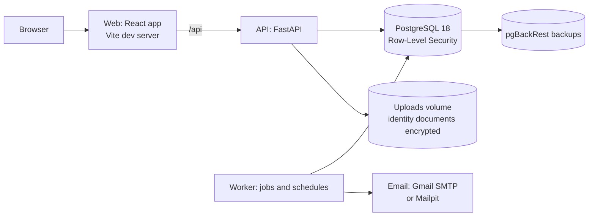

# Nivas: hostel management

Nivas is a multi-tenant web application for colleges and hostel operators. Each organization runs its own
hostels (rooms, beds, students, fees, leave, complaints and the mess menu), and its data is kept strictly
apart from every other organization's, down to the database.

Built with FastAPI, PostgreSQL 18 and React, and run locally with Docker Compose. Every tool and library is
free and open source.

## Features

- **Self-service organizations:** an organization registers itself and confirms its email. The person who
  registered it becomes its one **Administrator**.
- **Hostel structure:** hostels, buildings, floors, room types, rooms and beds, typed in or imported from CSV.
- **Students:** admission with a photo and guardians. Identity documents are encrypted at rest, and only the
  last four digits of an ID are stored. An emailed activation link starts the account; students can also ask
  to register, and the Administrator approves or rejects them.
- **Bed map:** a visual floor plan with vacant, occupied, reserved and maintenance beds. Allocate, reserve,
  check in, transfer and check out from a side panel. Double booking is impossible.
- **Fees and payments:** fee structures, charge runs, late fees, fines and waivers. Cash, UPI and bank payments
  get gap-free PDF receipts. Students submit UPI payments for verification. Deposits and refunds are tracked;
  the ledger is append-only and mistakes are fixed with reversals.
- **Leave and complaints:** students request leave and raise complaints with photos; the Administrator decides.
  A resolved complaint can be reopened within 7 days.
- **Mess menu, announcements and notifications:** a weekly menu, announcements, and an in-app bell with unread
  counts. Email goes through Gmail SMTP when configured, otherwise to a local test inbox (Mailpit).
- **Student portal:** fees and receipts, a UPI QR code, leave, complaints, the menu and announcements.
- **Audit log:** every change is recorded as a plain sentence ("Kavita Deshpande approved a refund of ₹2,500
  for Saurabh Parikh") and can never be edited.
- **Platform console:** the platform operator sees organizations with totals only (never students' personal
  data), and can suspend or reactivate one. It also has a health page and a masked audit log.
- **Operations:** continuous backups with point-in-time restore, a restore drill script and data-key rotation.

## Tech stack

| Layer | Tools |
|---|---|
| Frontend | React 19, TypeScript, Vite, Tailwind CSS, shadcn/ui (Radix), TanStack Query, React Hook Form + Zod, lucide icons |
| Backend | Python 3.13, FastAPI, SQLAlchemy 2, Pydantic 2, Alembic, Argon2id, WeasyPrint (PDF receipts) |
| Database | PostgreSQL 18 with Row-Level Security, exclusion constraints and triggers; pgBackRest for backups |
| Email | SMTP: Gmail with an app password, or Mailpit for development |
| Tests | pytest against a real PostgreSQL, Vitest + Testing Library, Playwright browser flows |
| Quality gate | ruff, mypy, pip-audit, ESLint, `tsc`, npm audit, gitleaks |
| Runtime | Docker Desktop (WSL2 backend) and Docker Compose on Windows |

## Architecture

A modular monolith: one FastAPI application split into modules (students, allocations, finance, leave and so
on), plus a worker process that runs the same code for background jobs.



- **Tenant isolation in two layers:** the organization comes only from the signed-in session, and every query
  is scoped to it. PostgreSQL Row-Level Security refuses other organizations' rows even if application code is
  wrong.
- **The database enforces the hard rules:** no double booking (exclusion constraints), an append-only ledger,
  gap-free receipt numbers and an immutable audit log (privileges plus triggers).
- **Background work** (email, charge runs, late fees, expiring reservations) goes through a jobs table written
  in the same transaction as the change that caused it.

The design documents in [`docs/`](docs/) explain each part:
[requirements](docs/01-understanding-and-requirements.md), [architecture](docs/02-architecture-overview.md),
[database](docs/03-database-design.md), [API](docs/04-api-design.md), [security](docs/05-security-analysis.md),
[development plan](docs/06-development-plan.md) and [costs and licences](docs/07-zero-budget-review.md).
References such as Q7 or D87 in them point to entries in the project's decision log, which is kept outside
this repository.

## Screenshots

<!-- Add images to docs/screenshots/ and replace these placeholders. -->

| | |
|---|---|
| Landing page | _docs/screenshots/landing.png_ |
| Bed map | _docs/screenshots/bed-map.png_ |
| Audit log | _docs/screenshots/audit-log.png_ |
| Student portal: fees | _docs/screenshots/portal-fees.png_ |
| Platform console | _docs/screenshots/platform.png_ |

## Run it locally on Windows, from zero

You need about 10 GB of free disk and 8 GB of RAM. Python, Node and every library run inside the containers.

### 1. Install the tools (once)

1. **WSL2:** in PowerShell as Administrator, run `wsl --install`, then restart.
2. **Docker Desktop:** install it, choose the WSL2 backend, and start it. It is free for personal and
   educational use ([licence notes](docs/07-zero-budget-review.md)).
3. **Git for Windows:** install it. It also provides **Git Bash**, which runs the commands below.

### 2. Get the code

```bash
git clone https://github.com/utkarshdhama03/nivas-hostel-management.git
cd nivas-hostel-management
```

### 3. Create the secrets folder, outside the project

Secrets and keys never go inside the project folder. Create `C:\Users\<you>\hms-secrets\` with these files.
Generate each random value in Git Bash with `openssl rand -base64 32`.

| File | Contents |
|---|---|
| `hms-app.env` | `HMS_APP_PASSWORD=…`, `HMS_WORKER_PASSWORD=…`, `HMS_PLATFORM_PASSWORD=…`, `HMS_JWT_ORG_KEYS=k1:<random>` and `HMS_JWT_PLATFORM_KEYS=p1:<a different random value>` (the API refuses to start without the two signing keys) |
| `hms-admin.env` | `POSTGRES_PASSWORD=…`, `HMS_OWNER_PASSWORD=…`, `HMS_BACKUP_PASSWORD=…` |
| `data-keys.json` | `{"active": "k1", "keys": {"k1": "<random>"}}`: the key that encrypts identity documents |
| `pgbackrest.env` | `PGBACKREST_REPO1_CIPHER_PASS=…`: encrypts the backups |
| `hms-mail.env` (optional) | `HMS_GMAIL_ADDRESS=you@gmail.com` and `HMS_GMAIL_APP_PASSWORD=…` (Google Account → Security → 2-Step Verification → App passwords). Without it, all email lands in Mailpit. Test addresses (`.example`, `.test`, …) always go to Mailpit. |
| `demo-passwords.env` (only for demo data) | `HMS_DEMO_ADMIN_PASSWORD=…`, `HMS_DEMO_OWNER_PASSWORD=…`, `HMS_DEMO_STUDENT_PASSWORD=…` (at least 8 characters each, not a common password) |

**Keep an offline copy of this folder** (for example on a USB drive). Losing every copy of `data-keys.json`
makes identity documents unreadable for good ([key runbook](docs/runbooks/keys.md)).

### 4. Point the project at the secrets folder

```bash
cp .env.example .env
# edit .env: HMS_SECRETS_DIR=C:/Users/<you>/hms-secrets
```

### 5. Start everything and create the database

```bash
docker compose up -d --build                          # first time: about 10 minutes
docker compose run --rm tools alembic upgrade head    # creates the schema
docker compose run --rm tools python -m app.cli create-platform-owner --email you@example.com --name "Your Name"
```

The last command asks for the Platform Owner's password at a hidden prompt. A forgotten one is reset with
`docker compose run --rm tools python -m app.cli reset-platform-owner-password --email you@example.com`.

### 6. Open it

| What | Address |
|---|---|
| The app (landing page, sign-in, registration) | http://localhost:5173 |
| Platform console | http://localhost:5173/platform/login |
| Test inbox (Mailpit) | http://localhost:8025 |
| API health and docs | http://localhost:8000/api/v1/health/live, http://localhost:8000/api/v1/docs |

Register an organization from the landing page and confirm the email in Mailpit. Everything listens on
localhost only.

## Demo data

```bash
./scripts/demo-data.sh create    # about 3 minutes; safe to run again
./scripts/demo-data.sh status    # what exists
./scripts/demo-data.sh reset     # removes only the demo organizations
```

This builds two organizations with about three months of history, created through the application's own
services so every rule shaped the data:

- **Demo University Hostels:** 2 hostels, 228 beds and about 200 students;
- **Sunrise Girls Hostel:** a small second organization, for showing isolation.

It also creates a demo Platform Owner. All names are invented, emails use the reserved `.example` domain, and
documents are stamped "SAMPLE – DEMO DATA". The passwords come from `demo-passwords.env`. The list of logins is
written to `demo-logins.md` in the secrets folder, never into the project.

Before a live demo, raise the registration limit (3 an hour per address; every browser request reaches the API
through the same proxy): `HMS_E2E_REGISTRATIONS=50 docker compose up -d --force-recreate api`.

## Tests and the quality gate

| What | Command |
|---|---|
| Full quality gate: lint, formatting, types, all tests, dependency audit, API-types drift check, secret scan | `./scripts/check.sh` |
| Backend tests only (including the database proof suite) | `docker compose run --rm tools pytest` |
| Browser flows (Playwright; on their own database, `hms_e2e`) | `./scripts/e2e.sh` |
| Point-in-time restore drill (on a throwaway copy) | `./scripts/drill-pitr.sh` |
| Scale test (50 organizations × 5,000 students, about 15 minutes) | `./scripts/scale-test.sh` |

The current suite has 987 backend tests, 168 frontend tests and 12 browser flows. The backend tests run
against a real PostgreSQL as the same database roles the app uses. A cross-tenant attack and a permission
check are generated for every API route, and a route nobody classified fails the build. Tests run on a
frozen clock.

## Everyday commands

| What | Command |
|---|---|
| Start / stop | `docker compose up -d` / `docker compose down` |
| Logs | `docker compose logs -f api` |
| Apply migrations | `docker compose run --rm tools alembic upgrade head` |
| Database shell | `docker compose exec db psql -U postgres -d hms` |
| Reset the development database | `./scripts/db-reset.sh` (asks first) |
| Regenerate the frontend's API types | `./scripts/gen-api.sh` |
| Backup status | `docker compose exec -u postgres db pgbackrest --stanza=hms info` |
| Restore, key loss, key rotation | [restore runbook](docs/runbooks/restore.md), [key runbook](docs/runbooks/keys.md) |

Backups go to a Docker volume on the same disk until `HMS_BACKUP_DIR` in `.env` points to another drive. The
database is published on port 5433 (`HMS_DB_HOST_PORT`), because 5432 is often taken by a native PostgreSQL.
Auto-reload uses file polling, because the project lives on the Windows filesystem.

## Project structure

```
backend/
  app/
    core/            request pipeline, tenant context, auth tokens, passwords, audit, jobs, encryption
    modules/         one folder per feature: students, allocations, finance, leave, complaints, ...
    templates/       email and receipt templates
    cli.py           Platform Owner and key-management commands
    worker.py        background jobs and schedules
  migrations/sql/    the schema as plain SQL, the source of truth (each migration has a down/ folder)
  tests/             pytest: API, security suites (tests/security), database proofs (tests/dbproof), demo seed
frontend/
  src/pages/         admin area, student portal, platform console, public pages
  src/api/           generated OpenAPI types and the API client
  e2e/               Playwright browser flows
docker/              PostgreSQL 18 + pgBackRest image; the browser-test image
scripts/             quality gate, browser flows, demo data, database reset, restore drill, scale test
docs/                design documents 01–07 and runbooks
compose.yaml         the whole stack
```

## Known limitations

- **The password is the only factor:** there is no two-step verification. Account lockout, per-IP limits and a
  common-password check reduce the risk.
- **One Administrator per organization,** trusted with everything. The audit log records every action, but
  nobody inside the organization reviews them.
- **Local only:** no hosting set up, and backups have no off-site copy.
- **No online payment gateway.** Students pay by UPI and submit the reference for verification.
- **No antivirus scan of uploads,** and no automatic check that an Aadhaar PDF really is masked.
- **A database superuser could alter history:** a tamper-evident hash chain for the audit log is not built.

## Licence

[MIT](LICENSE) © 2026 Utkarsh Dhama. Third-party components keep their own licences
([list](docs/07-zero-budget-review.md)).
