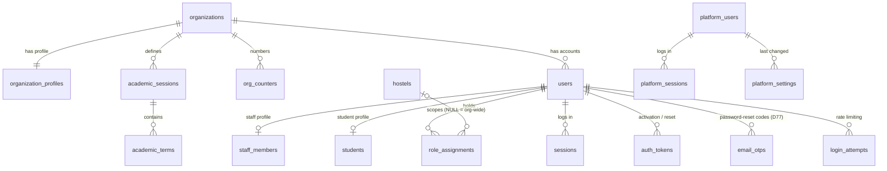
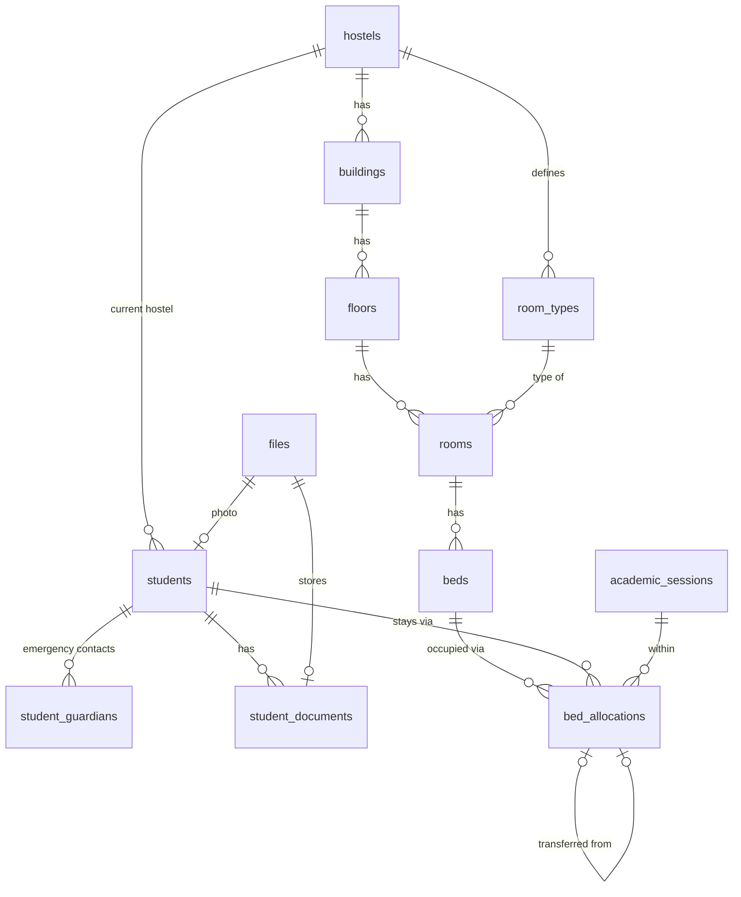
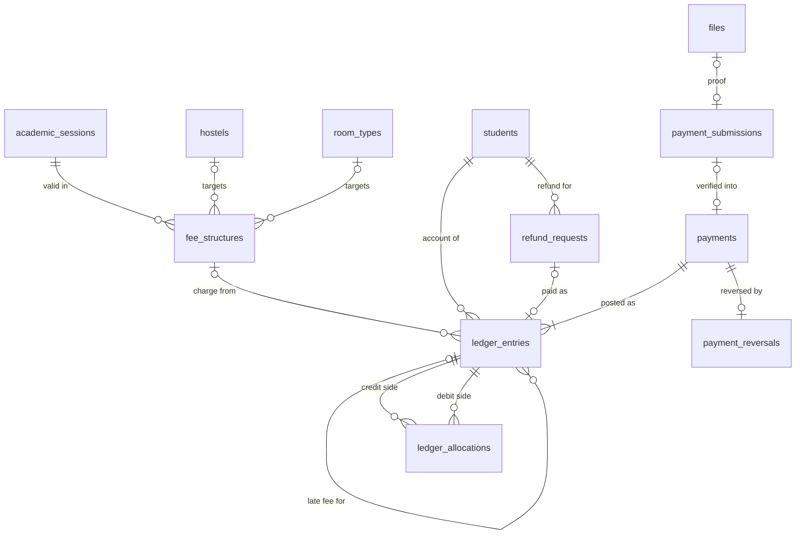
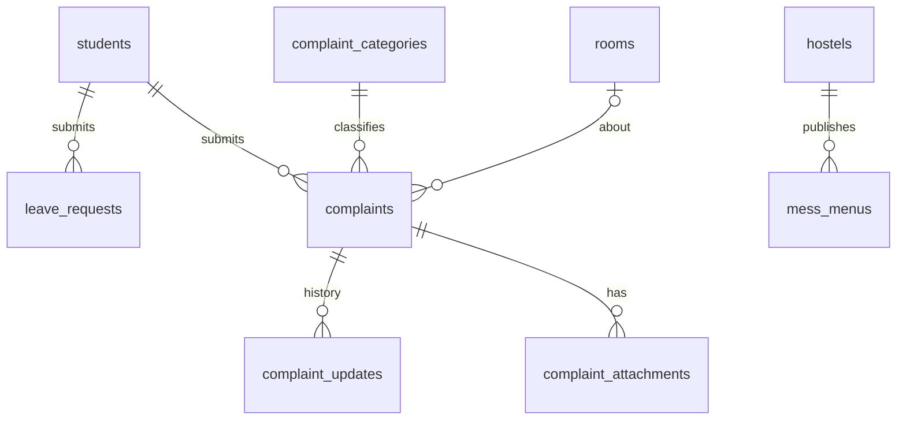
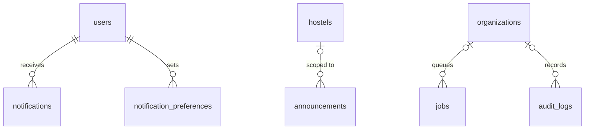

# 03 — Database Design

| | |
|---|---|
| Status | Implements decisions Q1–Q74 (the project's decision log). The §10 proposals were reviewed on 2026-11-07 (Q60–Q63). Changes are logged in §13. **From Phase 0 on, the SQL in `backend/migrations/sql/0001_baseline/` is the source of truth; this document mirrors it.** |
| Related | [01-understanding-and-requirements.md](01-understanding-and-requirements.md), [02-architecture-overview.md](02-architecture-overview.md) |
| Target | PostgreSQL 18 |
| Date | 2026-11-07 |

**How to read this.** The SQL below is the *specification*: every table, column, type, key, constraint, index, RLS policy and trigger. During scaffolding it becomes SQLAlchemy models plus Alembic migrations, reviewed against this document. **It has not been run against a real PostgreSQL server yet**; that is the first verification step when we scaffold (§11).

The ER diagrams use Mermaid. If VS Code's Markdown preview shows them as code, the free "Markdown Preview Mermaid Support" extension renders them.

---

## 1. Conventions

| Topic | Convention | Why |
|---|---|---|
| Table names | Plural `snake_case` | Readable SQL; matches SQLAlchemy defaults we'll configure. |
| Primary keys | `id uuid DEFAULT uuidv7()` | Not guessable (no `/students/1235` enumeration); time-ordered, so index inserts stay efficient. The app may also generate UUIDv7s itself when it needs an ID before inserting (e.g. a student's photo file). |
| Tenant column | `org_id uuid NOT NULL` on every organization-owned table | Shared-table multi-tenancy (brief §7). Server-set, never client-set. |
| Composite keys for references | Every referenced tenant table has `UNIQUE (org_id, id)`. Children reference `(org_id, parent_id)` | The database itself rejects a row that points at another organization's parent. A plain `parent_id` FK would allow it. |
| Hostel consistency | `hostel_id` is copied down the chain (building → floor → room → bed → allocation), with FKs on `(org_id, hostel_id, parent_id)` | Hostel-scoped queries need no 4-table joins, and the database guarantees the copy is always correct. |
| Text | `text` + `CHECK` on length/format, not `varchar(n)` | Same performance in PostgreSQL; CHECKs state the real rule and are easy to change in a migration. |
| Enumerations | `text` + `CHECK (x IN (...))`, not PostgreSQL `ENUM` types | Adding or removing a value is a simple constraint change; ENUM values are hard to remove. |
| Timestamps | `timestamptz`, stored in UTC; `created_at` on every table, `updated_at` on mutable ones (set by the app) | Display uses the organization's timezone (Q48). |
| Dates without time | `date` (check-in dates, due dates, session dates) | A due date isn't a moment. |
| Money | `numeric(12,2)` in rupees; Python `Decimal`; strings in JSON | Exact arithmetic; JavaScript numbers are floats. Max ₹9,99,99,99,999.99. |
| Deleting | The app roles have **no DELETE privilege** on business tables. Records change status instead (`is_active`, `status`, `revoked_at`, `deleted_at`) | History and audit stay intact. Only the worker purges expiring security data (§2). |
| Append-only tables | `ledger_entries`, `ledger_allocations` (except its one-time release columns), `payments`, `payment_reversals`, `complaint_updates`, `audit_logs` | No UPDATE/DELETE privilege + a trigger that raises an error anyway (§7). |
| Optimistic locking (Q70) | Every table edited through `PATCH` has `version integer NOT NULL DEFAULT 1` (19 tables: `platform_settings`, `organizations`, `organization_profiles`, `academic_sessions`, `academic_terms`, `hostels`, `buildings`, `floors`, `room_types`, `rooms`, `beds`, `users`, `staff_members`, `students`, `student_guardians`, `fee_structures`, `complaint_categories`, `complaints`, `mess_menus`). Edits run `UPDATE … SET …, version = version + 1 WHERE id = :id AND version = :expected`; 0 rows → `409 edit_conflict` (04 §10). | Two admins editing the same record get a clear conflict instead of a silent overwrite. SQLAlchemy's `version_id_col` does this automatically. Workflow tables (allocations, leave, gate passes, refunds, submissions, attendance) don't need it: their actions are already conditional status updates that reject stale actions. |
| Encryption at rest (Q65) | Identity-document files are encrypted with AES-256-GCM using application keys that live outside the database; each encrypted file stores the ID of the key used (`encryption_key_id`) | §5.5.1 |
| Clocks (D67, migration 0005) | **Business** tables and business logic use `app_now()`: the transaction-local `app.now` that the application sets from its own clock at the start of every transaction, or the real `now()` when unset. Tests freeze the application clock and the database follows. **Security** tables keep the real `now()`, so no application code can backdate their timestamps: `audit_logs`, `login_attempts`, `sessions`, `platform_sessions`, `auth_tokens`, `email_otps`, `user_recovery_codes`, `platform_recovery_codes`, `qr_redemptions`, `role_assignments`, `users`, `platform_users`, `platform_settings`, `jobs`, `backup_runs`. A timestamp is compared with the clock that wrote it. | `tests/test_clock.py` proves it, and fails on a new time default that isn't classified. |
| JSONB | Only for genuinely free-form data: organization settings, job payloads (IDs only), audit before/after values, backup details | Everything we query or constrain is a real column. |
| Views | Created `WITH (security_invoker = true)` | So RLS is evaluated for the querying role, not the view's owner. |
| Indexes | Unique constraints create their own indexes. Other indexes start with `org_id` (RLS adds `org_id = …` to every query) | PostgreSQL does not index foreign keys automatically; lookups we actually run get explicit indexes. |

## 2. Database roles and privileges

| Role | Login? | Used by | Privileges |
|---|---|---|---|
| `hms_owner` | yes (migrations only) | Alembic | Owns every object. Never used by the running app. |
| `hms_app` | yes | API process | SELECT/INSERT/UPDATE on mutable tenant tables; SELECT/INSERT only on append-only tables; **no DELETE anywhere**; **no privileges at all** on `platform_*` and `backup_runs`. Subject to RLS. |
| `hms_worker` | yes | Worker process | Everything `hms_app` has, plus: an RLS policy to claim jobs of any organization (§6), and DELETE on purgeable security data only (`login_attempts`, `email_otps`, `auth_tokens`, finished `jobs`, and since D74 `student_registration_requests`). |
| `hms_platform` | yes | `platform` module only | **No BYPASSRLS.** Full access to `platform_*` tables; SELECT on `backup_runs`; column-limited SELECT on a short list of tenant tables through dedicated policies (§6); UPDATE of the suspension columns on `organizations`; INSERT on `audit_logs`; EXECUTE on `platform_reset_super_admin_mfa()` (§7). |
| `hms_backup` | yes | pgBackRest, backup scripts | Backup privileges per pgBackRest documentation; INSERT/UPDATE on `backup_runs`. |

## 3. Shared definitions

```sql
CREATE EXTENSION IF NOT EXISTS btree_gist;   -- lets exclusion constraints mix uuid "=" with range "&&"

-- Current tenant, set per transaction by the app: SELECT set_config('app.org_id', '<uuid>', true)
CREATE FUNCTION app_current_org() RETURNS uuid
  LANGUAGE sql STABLE
  AS $$ SELECT NULLIF(current_setting('app.org_id', true), '')::uuid $$;

-- Used by append-only tables
CREATE FUNCTION forbid_change() RETURNS trigger
  LANGUAGE plpgsql AS $$
BEGIN
  RAISE EXCEPTION 'table % is append-only', TG_TABLE_NAME;
END $$;
```

`NULLIF(..., '')` matters: after a transaction ends, a custom setting already used on that connection reads as `''`, and `''::uuid` would raise an error instead of returning no rows.

### Extensions and built-in features the SQL relies on

Checked against every SQL block in this document on 2026-11-07. **`btree_gist` is the only extension needed, and it is created at the top of §3, before any table that uses it.**

| Extension / feature | Needed? | Used by | Notes |
|---|---|---|---|
| `btree_gist` | **Yes**: `CREATE EXTENSION IF NOT EXISTS btree_gist;` (above) | The 4 exclusion constraints that combine a uuid `=` with a range `&&`: `academic_terms` (no overlapping terms), `bed_allocations.bed_no_overlap`, `bed_allocations.student_no_overlap`, `leave_requests.leave_no_overlap` | Without it, those four `CREATE TABLE` statements fail. Ships with the official `postgres` Docker image (contrib). It is marked "trusted" (PostgreSQL 13+), so `hms_owner` can create it in the first migration without superuser rights; to be confirmed when the DDL is first run. |
| `uuidv7()` | Built in (PostgreSQL 18) | Every primary-key default | No `uuid-ossp` or `pgcrypto` needed. |
| `NULLS NOT DISTINCT` | Built in (15+) | `role_assignments_active_uq` | |
| `security_invoker` views | Built in (15+) | `bed_states` view (§9) | |
| Range types, GiST, exclusion constraints, generated columns, column privileges, RLS, `SECURITY DEFINER` functions | Built in | Throughout | |
| `pgcrypto`, `uuid-ossp`, `citext`, `pg_trgm` | **Not used** | — | Hashing and encryption happen in Python; emails are compared with `lower()`. `pg_trgm` (fuzzy search) would be added only with approval, if name search ever gets slow. |

---

## 4. Entity-relationship diagrams

Every tenant table also belongs to `organizations`. Those links are left out below to keep the diagrams readable.

### 4.1 Organizations, identity and access



### 4.2 Hostel structure, students and allocation



### 4.3 Fees, payments and the ledger



### 4.4 Daily operations



### 4.5 Cross-cutting



`audit_logs` deliberately has no foreign keys to actors or entities (§5.16).

---

## 5. Tables

Sections are ordered so that every referenced table is defined before the tables that reference it.

### 5.1 Platform (no organization; no RLS; `hms_app` has no access)

```sql
CREATE TABLE platform_users (
  id                     uuid PRIMARY KEY DEFAULT uuidv7(),
  email                  text NOT NULL CHECK (email ~ '^[^@\s]+@[^@\s]+\.[^@\s]+$'),
  full_name              text NOT NULL CHECK (length(full_name) BETWEEN 1 AND 120),
  password_hash          text NOT NULL,
  status                 text NOT NULL DEFAULT 'active' CHECK (status IN ('active','disabled')),
  failed_login_count     smallint NOT NULL DEFAULT 0 CHECK (failed_login_count >= 0),
  locked_until           timestamptz,
  last_login_at          timestamptz,
  created_at             timestamptz NOT NULL DEFAULT now(),
  updated_at             timestamptz NOT NULL DEFAULT now()
);
CREATE UNIQUE INDEX platform_users_email_uq ON platform_users (lower(email));

CREATE TABLE platform_sessions (
  id                   uuid PRIMARY KEY DEFAULT uuidv7(),
  platform_user_id     uuid NOT NULL REFERENCES platform_users (id),
  family_id            uuid NOT NULL,           -- all rotations of one login share this
  refresh_token_hash   text NOT NULL UNIQUE,
  created_at           timestamptz NOT NULL DEFAULT now(),
  last_used_at         timestamptz,
  expires_at           timestamptz NOT NULL,
  absolute_expires_at  timestamptz NOT NULL,
  revoked_at           timestamptz,
  revoke_reason        text CHECK (revoke_reason IN ('logout','rotated','reuse_detected','admin','expired')),
  ip_address           inet,
  user_agent           text,
  CHECK (expires_at <= absolute_expires_at),
  CHECK ((revoked_at IS NULL) = (revoke_reason IS NULL))
);
CREATE INDEX ON platform_sessions (platform_user_id) WHERE revoked_at IS NULL;
CREATE INDEX ON platform_sessions (family_id);

CREATE TABLE platform_settings (
  key         text PRIMARY KEY CHECK (key ~ '^[a-z][a-z0-9_.]{2,63}$'),
  version  integer NOT NULL DEFAULT 1 CHECK (version >= 1),   -- optimistic locking (Q70)
  value       jsonb NOT NULL,
  updated_by  uuid NOT NULL REFERENCES platform_users (id),
  updated_at  timestamptz NOT NULL DEFAULT now()
);

CREATE TABLE backup_runs (
  id           uuid PRIMARY KEY DEFAULT uuidv7(),
  kind         text NOT NULL CHECK (kind IN ('full','differential','logical_dump','file_copy','verify','restore_test')),
  status       text NOT NULL CHECK (status IN ('running','succeeded','failed')),
  started_at   timestamptz NOT NULL DEFAULT now(),
  finished_at  timestamptz,
  size_bytes   bigint CHECK (size_bytes >= 0),
  details      jsonb NOT NULL DEFAULT '{}',
  CHECK ((status = 'running') = (finished_at IS NULL))
);
CREATE INDEX ON backup_runs (kind, started_at DESC);
```

*Design notes:* Platform Owners are kept apart from organization users so no tenant table ever needs a NULL `org_id`, and so `hms_app` (the role every tenant request uses) can't touch platform accounts at all.

### 5.2 Organizations

```sql
CREATE TABLE organizations (
  id                 uuid PRIMARY KEY DEFAULT uuidv7(),
  version  integer NOT NULL DEFAULT 1 CHECK (version >= 1),   -- optimistic locking (Q70)
  slug               text NOT NULL UNIQUE
                     CHECK (slug ~ '^[a-z0-9][a-z0-9-]{1,38}[a-z0-9]$')            -- 3–40 chars (Q8)
                     CHECK (slug NOT IN ('admin','api','app','platform','portal','static','www')),
  name               text NOT NULL CHECK (length(name) BETWEEN 2 AND 120),
  status             text NOT NULL DEFAULT 'pending_verification'
                     CHECK (status IN ('pending_verification','active','suspended')),
  timezone           text NOT NULL DEFAULT 'Asia/Kolkata',                           -- validated by the app (Q48)
  email_verified_at  timestamptz,
  suspended_at       timestamptz,
  suspension_reason  text,
  created_at         timestamptz NOT NULL DEFAULT now(),
  updated_at         timestamptz NOT NULL DEFAULT now(),
  CHECK (status = 'pending_verification' OR email_verified_at IS NOT NULL),
  CHECK ((status = 'suspended') = (suspended_at IS NOT NULL)),
  CHECK (suspended_at IS NULL OR suspension_reason IS NOT NULL)
);
CREATE INDEX ON organizations (status);

-- Only these status changes are allowed, and suspension is Platform-Owner-only (Q13, Q14)
CREATE FUNCTION organizations_status_guard() RETURNS trigger LANGUAGE plpgsql AS $$
BEGIN
  IF NEW.status IS DISTINCT FROM OLD.status THEN
    IF OLD.status = 'pending_verification' AND NEW.status = 'active' THEN
      RETURN NEW;                                            -- email verification
    ELSIF current_user = 'hms_platform'
      AND (OLD.status, NEW.status) IN (('active','suspended'), ('suspended','active')) THEN
      RETURN NEW;                                            -- suspend / reactivate
    END IF;
    RAISE EXCEPTION 'organization status change % -> % is not allowed', OLD.status, NEW.status;
  END IF;
  RETURN NEW;
END $$;
CREATE TRIGGER organizations_status_guard BEFORE UPDATE ON organizations
  FOR EACH ROW EXECUTE FUNCTION organizations_status_guard();

CREATE TABLE organization_profiles (
  org_id          uuid PRIMARY KEY REFERENCES organizations (id),
  version  integer NOT NULL DEFAULT 1 CHECK (version >= 1),   -- optimistic locking (Q70)
  legal_name      text,
  contact_email   text NOT NULL CHECK (contact_email ~ '^[^@\s]+@[^@\s]+\.[^@\s]+$'),
  contact_phone   text CHECK (contact_phone ~ '^\+?[0-9][0-9 -]{6,19}$'),
  address_line1   text,
  address_line2   text,
  city            text,
  state           text,
  postal_code     text CHECK (postal_code ~ '^[0-9]{6}$'),
  upi_id          text CHECK (upi_id ~ '^[A-Za-z0-9._-]{2,255}@[A-Za-z]{2,64}$'),   -- Q28
  upi_payee_name  text,
  settings        jsonb NOT NULL DEFAULT '{}',     -- UI-level preferences; schema validated by Pydantic
  updated_at      timestamptz NOT NULL DEFAULT now(),
  CHECK (upi_id IS NULL OR upi_payee_name IS NOT NULL)
);

CREATE TABLE academic_sessions (
  id          uuid PRIMARY KEY DEFAULT uuidv7(),
  version  integer NOT NULL DEFAULT 1 CHECK (version >= 1),   -- optimistic locking (Q70)
  org_id      uuid NOT NULL REFERENCES organizations (id),
  name        text NOT NULL CHECK (length(name) BETWEEN 2 AND 40),     -- e.g. '2026-27' (Q18)
  starts_on   date NOT NULL,
  ends_on     date NOT NULL,
  is_current  boolean NOT NULL DEFAULT false,
  created_at  timestamptz NOT NULL DEFAULT now(),
  UNIQUE (org_id, id),
  UNIQUE (org_id, name),
  CHECK (ends_on > starts_on)
);
CREATE UNIQUE INDEX academic_sessions_one_current_uq ON academic_sessions (org_id) WHERE is_current;

CREATE TABLE academic_terms (                      -- needed for the 'term' billing cycle (Q24)
  id                   uuid PRIMARY KEY DEFAULT uuidv7(),
  version  integer NOT NULL DEFAULT 1 CHECK (version >= 1),   -- optimistic locking (Q70)
  org_id               uuid NOT NULL REFERENCES organizations (id),
  academic_session_id  uuid NOT NULL,
  name                 text NOT NULL CHECK (length(name) BETWEEN 2 AND 40),
  starts_on            date NOT NULL,
  ends_on              date NOT NULL,
  created_at           timestamptz NOT NULL DEFAULT now(),
  UNIQUE (org_id, id),
  UNIQUE (academic_session_id, name),
  FOREIGN KEY (org_id, academic_session_id) REFERENCES academic_sessions (org_id, id),
  CHECK (ends_on > starts_on),
  EXCLUDE USING gist (academic_session_id WITH =, (daterange(starts_on, ends_on, '[]')) WITH &&)
);

CREATE TABLE org_counters (                        -- gap-free numbering (receipts Q29, student/employee codes)
  org_id      uuid NOT NULL REFERENCES organizations (id),
  name        text NOT NULL CHECK (name IN ('receipt','student_code','employee_code')),
  scope_key   text NOT NULL CHECK (scope_key ~ '^[0-9]{4}(-[0-9]{2})?$'),   -- '2026-27' or '2026'
  last_value  bigint NOT NULL DEFAULT 0 CHECK (last_value >= 0),
  PRIMARY KEY (org_id, name, scope_key)
);
```

*Design notes:* `organizations` holds only what the login page needs (slug, name, status, timezone), because **every** role can read it: the slug must be resolved before anyone is logged in. Contact details live in `organization_profiles`, which is tenant-protected.

### 5.3 Hostel structure

```sql
CREATE TABLE hostels (
  id                              uuid PRIMARY KEY DEFAULT uuidv7(),
  version  integer NOT NULL DEFAULT 1 CHECK (version >= 1),   -- optimistic locking (Q70)
  org_id                          uuid NOT NULL REFERENCES organizations (id),
  code                            text NOT NULL CHECK (code ~ '^[A-Z0-9-]{1,12}$'),
  name                            text NOT NULL CHECK (length(name) BETWEEN 2 AND 120),
  resident_type                   text CHECK (resident_type IN ('boys','girls','coed')),   -- Q19
  address                         text,
  local_outing_requires_approval  boolean NOT NULL DEFAULT true,                            -- Q35
  is_active                       boolean NOT NULL DEFAULT true,
  created_at                      timestamptz NOT NULL DEFAULT now(),
  updated_at                      timestamptz NOT NULL DEFAULT now(),
  UNIQUE (org_id, id),
  UNIQUE (org_id, code),
  UNIQUE (org_id, name)
);

CREATE TABLE buildings (
  id          uuid PRIMARY KEY DEFAULT uuidv7(),
  version  integer NOT NULL DEFAULT 1 CHECK (version >= 1),   -- optimistic locking (Q70)
  org_id      uuid NOT NULL REFERENCES organizations (id),
  hostel_id   uuid NOT NULL,
  name        text NOT NULL CHECK (length(name) BETWEEN 1 AND 60),
  is_active   boolean NOT NULL DEFAULT true,
  created_at  timestamptz NOT NULL DEFAULT now(),
  UNIQUE (org_id, hostel_id, id),
  UNIQUE (org_id, hostel_id, name),
  FOREIGN KEY (org_id, hostel_id) REFERENCES hostels (org_id, id)
);

CREATE TABLE floors (
  id           uuid PRIMARY KEY DEFAULT uuidv7(),
  version  integer NOT NULL DEFAULT 1 CHECK (version >= 1),   -- optimistic locking (Q70)
  org_id       uuid NOT NULL REFERENCES organizations (id),
  hostel_id    uuid NOT NULL,
  building_id  uuid NOT NULL,
  level        smallint NOT NULL CHECK (level BETWEEN -5 AND 200),
  name         text,
  created_at   timestamptz NOT NULL DEFAULT now(),
  UNIQUE (org_id, hostel_id, id),
  UNIQUE (building_id, level),
  FOREIGN KEY (org_id, hostel_id, building_id) REFERENCES buildings (org_id, hostel_id, id)
);

CREATE TABLE room_types (                                       -- Q20
  id             uuid PRIMARY KEY DEFAULT uuidv7(),
  version  integer NOT NULL DEFAULT 1 CHECK (version >= 1),   -- optimistic locking (Q70)
  org_id         uuid NOT NULL REFERENCES organizations (id),
  hostel_id      uuid NOT NULL,
  name           text NOT NULL CHECK (length(name) BETWEEN 2 AND 60),   -- e.g. 'Double, AC'
  description    text,
  beds_per_room  smallint NOT NULL CHECK (beds_per_room BETWEEN 1 AND 20),
  is_active      boolean NOT NULL DEFAULT true,
  created_at     timestamptz NOT NULL DEFAULT now(),
  UNIQUE (org_id, hostel_id, id),
  UNIQUE (org_id, hostel_id, name),
  FOREIGN KEY (org_id, hostel_id) REFERENCES hostels (org_id, id)
);

CREATE TABLE rooms (
  id            uuid PRIMARY KEY DEFAULT uuidv7(),
  version  integer NOT NULL DEFAULT 1 CHECK (version >= 1),   -- optimistic locking (Q70)
  org_id        uuid NOT NULL REFERENCES organizations (id),
  hostel_id     uuid NOT NULL,
  floor_id      uuid NOT NULL,
  room_type_id  uuid NOT NULL,
  number        text NOT NULL CHECK (number ~ '^[A-Za-z0-9-]{1,10}$'),
  status        text NOT NULL DEFAULT 'available' CHECK (status IN ('available','maintenance','inactive')),
  notes         text,
  created_at    timestamptz NOT NULL DEFAULT now(),
  updated_at    timestamptz NOT NULL DEFAULT now(),
  UNIQUE (org_id, hostel_id, id),
  UNIQUE (floor_id, number),
  FOREIGN KEY (org_id, hostel_id, floor_id)     REFERENCES floors (org_id, hostel_id, id),
  FOREIGN KEY (org_id, hostel_id, room_type_id) REFERENCES room_types (org_id, hostel_id, id)
);
CREATE INDEX ON rooms (org_id, hostel_id, status);
CREATE INDEX ON rooms (org_id, room_type_id);

CREATE TABLE beds (
  id          uuid PRIMARY KEY DEFAULT uuidv7(),
  version  integer NOT NULL DEFAULT 1 CHECK (version >= 1),   -- optimistic locking (Q70)
  org_id      uuid NOT NULL REFERENCES organizations (id),
  hostel_id   uuid NOT NULL,
  room_id     uuid NOT NULL,
  label       text NOT NULL CHECK (label ~ '^[A-Za-z0-9]{1,4}$'),     -- 'A', 'B', '1'
  status      text NOT NULL DEFAULT 'available' CHECK (status IN ('available','maintenance','inactive')),
  created_at  timestamptz NOT NULL DEFAULT now(),
  updated_at  timestamptz NOT NULL DEFAULT now(),
  UNIQUE (org_id, hostel_id, id),
  UNIQUE (room_id, label),
  FOREIGN KEY (org_id, hostel_id, room_id) REFERENCES rooms (org_id, hostel_id, id)
);
CREATE INDEX ON beds (org_id, hostel_id, status);
```

*Design notes:*
- A bed stores only **manual** states. "Occupied" and "reserved" are *derived* from `bed_allocations` (§9), so they can never drift out of sync.
- `room_type_id` is checked against the room's own hostel by the composite FK, so a room in Hostel A can't use Hostel B's room type.
- Hostel capacity (HST-2, PROPOSAL) = number of beds whose status isn't `inactive`.
- The time-of-day defaults are PROPOSALs (§10).

### 5.4 Users, authentication and roles

```sql
CREATE TABLE users (
  id                     uuid PRIMARY KEY DEFAULT uuidv7(),
  version  integer NOT NULL DEFAULT 1 CHECK (version >= 1),   -- optimistic locking (Q70)
  org_id                 uuid NOT NULL REFERENCES organizations (id),
  kind                   text NOT NULL CHECK (kind IN ('staff','student')),
  full_name              text NOT NULL CHECK (length(full_name) BETWEEN 1 AND 120),
  email                  text CHECK (email ~ '^[^@\s]+@[^@\s]+\.[^@\s]+$'),   -- students always have one (D80); kept nullable in the schema
  email_verified_at      timestamptz,
  phone                  text CHECK (phone ~ '^\+?[0-9][0-9 -]{6,19}$'),
  password_hash          text,                    -- NULL until activation
  status                 text NOT NULL DEFAULT 'pending_activation'
                         CHECK (status IN ('pending_activation','active','read_only','deactivated')),
  read_only_until        date,                    -- exit window (Q22)
  failed_login_count     smallint NOT NULL DEFAULT 0 CHECK (failed_login_count >= 0),
  locked_until           timestamptz,
  last_login_at          timestamptz,
  created_by             uuid,
  created_at             timestamptz NOT NULL DEFAULT now(),
  updated_at             timestamptz NOT NULL DEFAULT now(),
  UNIQUE (org_id, id),
  FOREIGN KEY (org_id, created_by) REFERENCES users (org_id, id),
  CHECK (status NOT IN ('active','read_only') OR password_hash IS NOT NULL),
  CHECK ((status = 'read_only') = (read_only_until IS NOT NULL))
);
CREATE UNIQUE INDEX users_org_email_uq ON users (org_id, lower(email)) WHERE email IS NOT NULL;   -- Q9
CREATE INDEX ON users (org_id, kind, status);

CREATE TABLE sessions (
  id                   uuid PRIMARY KEY DEFAULT uuidv7(),
  org_id               uuid NOT NULL REFERENCES organizations (id),
  user_id              uuid NOT NULL,
  family_id            uuid NOT NULL,
  refresh_token_hash   text NOT NULL UNIQUE,
  created_at           timestamptz NOT NULL DEFAULT now(),
  last_used_at         timestamptz,
  expires_at           timestamptz NOT NULL,
  absolute_expires_at  timestamptz NOT NULL,
  revoked_at           timestamptz,
  revoke_reason        text CHECK (revoke_reason IN ('logout','rotated','reuse_detected','admin','deactivated','expired')),
  ip_address           inet,
  user_agent           text,
  FOREIGN KEY (org_id, user_id) REFERENCES users (org_id, id),
  CHECK (expires_at <= absolute_expires_at),
  CHECK ((revoked_at IS NULL) = (revoke_reason IS NULL))
);
CREATE INDEX ON sessions (org_id, user_id) WHERE revoked_at IS NULL;
CREATE INDEX ON sessions (org_id, family_id);

CREATE TABLE auth_tokens (                         -- activation, password reset, org registration
  id          uuid PRIMARY KEY DEFAULT uuidv7(),
  org_id      uuid NOT NULL REFERENCES organizations (id),
  user_id     uuid NOT NULL,
  purpose     text NOT NULL CHECK (purpose IN ('activation','org_registration')),  -- 'password_reset' removed by D77
  token_hash  text NOT NULL UNIQUE,
  delivery    text NOT NULL CHECK (delivery IN ('email','copied_link')),
  issued_by   uuid,                                -- the admin who copied the link (Q2)
  expires_at  timestamptz NOT NULL,
  used_at     timestamptz,
  revoked_at  timestamptz,
  created_at  timestamptz NOT NULL DEFAULT now(),
  FOREIGN KEY (org_id, user_id)   REFERENCES users (org_id, id),
  FOREIGN KEY (org_id, issued_by) REFERENCES users (org_id, id),
  CHECK (expires_at > created_at),
  CHECK (used_at IS NULL OR revoked_at IS NULL),
  CHECK ((delivery = 'copied_link') = (issued_by IS NOT NULL)),
  CHECK (delivery <> 'copied_link' OR purpose = 'activation')      -- only activation links may be copied
);
CREATE UNIQUE INDEX auth_tokens_one_live_uq ON auth_tokens (user_id, purpose)
  WHERE used_at IS NULL AND revoked_at IS NULL;

CREATE TABLE email_otps (                          -- the emailed password-reset code (D77); sign-in codes went (D87)
  id           uuid PRIMARY KEY DEFAULT uuidv7(),
  org_id       uuid NOT NULL REFERENCES organizations (id),
  user_id      uuid NOT NULL,
  code_hash    text NOT NULL,
  expires_at   timestamptz NOT NULL,
  attempts     smallint NOT NULL DEFAULT 0 CHECK (attempts BETWEEN 0 AND 5),
  consumed_at  timestamptz,
  created_at   timestamptz NOT NULL DEFAULT now(),
  FOREIGN KEY (org_id, user_id) REFERENCES users (org_id, id),
  CHECK (expires_at > created_at)
);
CREATE INDEX ON email_otps (org_id, user_id, created_at DESC);
-- D77 (migration 0010_reset_code) and D87 (0017_no_two_step): password-reset codes only.
--   purpose      text NOT NULL DEFAULT 'password_reset' CHECK (purpose = 'password_reset')
--   cancelled_at timestamptz   -- 5 wrong attempts, or a newer reset code was sent
--   email_otps_used_or_cancelled     CHECK (consumed_at IS NULL OR cancelled_at IS NULL)
--   email_otps_cancelled_after_five  CHECK (attempts < 5 OR consumed_at IS NOT NULL OR cancelled_at IS NOT NULL)
--   UNIQUE INDEX email_otps_one_live_reset ON (user_id)
--     WHERE purpose = 'password_reset' AND consumed_at IS NULL AND cancelled_at IS NULL

CREATE TABLE login_attempts (
  id               uuid PRIMARY KEY DEFAULT uuidv7(),
  org_id           uuid NOT NULL REFERENCES organizations (id),
  user_id          uuid,                           -- NULL when the identifier matched nobody
  identifier_hash  text NOT NULL,                  -- hash of what was typed, never the raw value
  ip_address       inet,
  succeeded        boolean NOT NULL,
  attempted_at     timestamptz NOT NULL DEFAULT now(),
  FOREIGN KEY (org_id, user_id) REFERENCES users (org_id, id)
);
CREATE INDEX ON login_attempts (org_id, identifier_hash, attempted_at DESC);
CREATE INDEX ON login_attempts (org_id, ip_address, attempted_at DESC);
CREATE INDEX ON login_attempts (attempted_at);   -- purge

CREATE TABLE staff_members (
  id             uuid PRIMARY KEY DEFAULT uuidv7(),
  version  integer NOT NULL DEFAULT 1 CHECK (version >= 1),   -- optimistic locking (Q70)
  org_id         uuid NOT NULL REFERENCES organizations (id),
  user_id        uuid NOT NULL,
  employee_code  text NOT NULL CHECK (employee_code ~ '^[A-Z0-9][A-Z0-9/-]{1,29}$'),   -- stored upper-case
  designation    text,
  joined_on      date,
  left_on        date,
  created_at     timestamptz NOT NULL DEFAULT now(),
  updated_at     timestamptz NOT NULL DEFAULT now(),
  UNIQUE (org_id, id),
  UNIQUE (org_id, employee_code),
  UNIQUE (org_id, user_id),
  FOREIGN KEY (org_id, user_id) REFERENCES users (org_id, id),
  CHECK (left_on IS NULL OR joined_on IS NULL OR left_on >= joined_on)
);

CREATE TABLE role_assignments (                    -- since D75/D76: only the one Administrator's grant
  id             uuid PRIMARY KEY DEFAULT uuidv7(),
  org_id         uuid NOT NULL REFERENCES organizations (id),
  user_id        uuid NOT NULL,
  role           text NOT NULL CONSTRAINT role_assignments_role_check CHECK (role = 'super_admin'),  -- "Administrator"
  granted_by     uuid,                              -- NULL for the Administrator created at registration
  granted_at     timestamptz NOT NULL DEFAULT now(),
  revoked_by     uuid,
  revoked_at     timestamptz,
  revoke_reason  text CHECK (revoke_reason IN ('role_removed_d75', 'extra_administrator_d76')),
  FOREIGN KEY (org_id, user_id)    REFERENCES users (org_id, id),
  FOREIGN KEY (org_id, granted_by) REFERENCES users (org_id, id),
  FOREIGN KEY (org_id, revoked_by) REFERENCES users (org_id, id),
  CHECK (granted_by IS NULL OR granted_by <> user_id),           -- nobody grants themselves a role
  CONSTRAINT role_assignments_revocation_check CHECK (
    (revoked_at IS NULL AND revoked_by IS NULL AND revoke_reason IS NULL)
    OR (revoked_at IS NOT NULL AND (revoked_by IS NOT NULL OR revoke_reason IS NOT NULL)))
);
CREATE UNIQUE INDEX role_assignments_active_uq ON role_assignments (org_id, user_id, role) WHERE revoked_at IS NULL;
CREATE UNIQUE INDEX role_assignments_one_administrator ON role_assignments (org_id)   -- D76
  WHERE role = 'super_admin' AND revoked_at IS NULL;
```

- **History:** migrations 0008 and 0009 (D75/D76) revoked the other roles and any extra Administrator (with `revoke_reason`); `0012_schema_cleanup` deleted the old roles' rows (the audit log keeps every grant and revocation) and dropped `hostel_id` (per-hostel roles, Q11).

*Design notes:*
- **Login lookups.** Since D78/D80 sign-in takes an email: `administrator_org()` / `student_org()` find the organization (§5.4a, §5.4b), then the user is looked up within it. The older `/o/{slug}/login` takes a Student ID, an Employee ID or an email within the organization named by the slug (Q8).
- **Refresh cookie** = `org_id . session_id . secret`. The org ID lets the server set the tenant context before it can even see the `sessions` row. Without the secret (checked against `refresh_token_hash`) the cookie is useless.
- Students have no `role_assignments`; their permissions come from `kind = 'student'`.

### 5.5 Files

```sql
CREATE TABLE files (
  id             uuid PRIMARY KEY DEFAULT uuidv7(),
  org_id         uuid NOT NULL REFERENCES organizations (id),
  category       text NOT NULL CHECK (category IN
                   ('student_photo','identity_document','admission_document','payment_proof','complaint_attachment')),
  storage_key    text NOT NULL UNIQUE
                 CHECK (storage_key ~ '^[0-9a-f-]{36}/[a-z_]+/[0-9]{4}/[0-9]{2}/[0-9a-f-]{36}$'),  -- no "../" possible
  original_name  text NOT NULL CHECK (length(original_name) BETWEEN 1 AND 255),
  mime_type      text NOT NULL CHECK (mime_type IN ('image/jpeg','image/png','image/webp','application/pdf')),
  size_bytes     bigint NOT NULL CHECK (size_bytes > 0 AND size_bytes <= 10485760),          -- 10 MB
  sha256         bytea NOT NULL CHECK (octet_length(sha256) = 32),
  uploaded_by    uuid NOT NULL,
  created_at     timestamptz NOT NULL DEFAULT now(),
  deleted_at     timestamptz,
  purged_at      timestamptz,
  access_level   text GENERATED ALWAYS AS
                   (CASE WHEN category = 'identity_document' THEN 'restricted' ELSE 'standard' END) STORED,   -- Q62
  encryption_key_id  text CHECK (encryption_key_id ~ '^[a-z0-9-]{1,32}$'),   -- data key used; NULL = not encrypted (Q65)
  UNIQUE (org_id, id),
  UNIQUE (org_id, id, category, mime_type),       -- lets student_documents pin the file's category and type
  FOREIGN KEY (org_id, uploaded_by) REFERENCES users (org_id, id),
  CHECK (category <> 'student_photo' OR mime_type LIKE 'image/%'),
  CHECK (purged_at IS NULL OR deleted_at IS NOT NULL),
  CHECK ((category = 'identity_document') = (encryption_key_id IS NOT NULL))     -- identity documents always encrypted (Q65)
);
CREATE INDEX ON files (deleted_at) WHERE deleted_at IS NOT NULL AND purged_at IS NULL;   -- purge job
```

*Design notes:* there's no "owner" column. A file is owned by whichever record points to it (`students.photo_file_id`, `student_documents.file_id`, `payment_submissions.proof_file_id`, `complaint_attachments.file_id`), and download permission follows that record. A polymorphic "owner_type + owner_id" pair couldn't have a real foreign key.

**File access by category (Q44, Q62).** The Administrator sees every file of the organization (Q59, D75); a student sees only their own photo, payment proofs and complaint attachments. The Platform Owner has no access to `files` or `student_documents` at all (§6).

| Category | `access_level` | Who can open the file | Delivery (04 §11) |
|---|---|---|---|
| `identity_document` | **restricted** (strictest) | **The Administrator. Nobody else**: not the student or the Platform Owner. Students see only the document type, masked number and verification status. | Only through an authenticated request (no shareable links), `Cache-Control: no-store`, **every download audited**, never included in exports |
| `admission_document` | standard | The Administrator | Short-lived signed link |
| `student_photo` | standard | The student; the Administrator | Short-lived signed link |
| `payment_proof` | standard | The submitting student; the Administrator | Short-lived signed link |
| `complaint_attachment` | standard | The submitting student; the Administrator | Short-lived signed link |

**Upload validation (Q66).** Every upload is checked for size, allowed type and real content: images must decode (Pillow re-encodes them); a PDF must start with a `%PDF-` header and end with an `%%EOF` trailer. There is **no automatic check of what's inside** an Aadhaar PDF in v1. The masked-number field and the uploader's attestation are the control (§5.6).

#### 5.5.1 Encryption at rest and key management (Q65)

**What is encrypted:** every `identity_document` file (the database requires `encryption_key_id` for that category). Other files are not encrypted; they're protected by access control.

**How (application layer, `cryptography` library):**

| Item | Detail |
|---|---|
| Cipher | AES-256-GCM (authenticated encryption: tampering is detected on decrypt) |
| Per item | A fresh random 96-bit nonce. Stored as `nonce ‖ ciphertext+tag`. |
| Binding (associated data) | Files: `org_id ‖ file_id ‖ category`. An encrypted blob copied onto another record fails to decrypt. |
| Integrity | `files.sha256` is the hash of the **plaintext**, checked after decryption |
| Key ID | Stored with every encrypted item (`encryption_key_id`), so keys can be rotated later |

**The keyring.** One or more 256-bit keys, each with an ID like `2026-11-a`. One is *active* (used for new encryption); older ones are kept only to decrypt. The API and worker load the keyring at startup from **either**:
1. the environment variable `HMS_DATA_KEYS`, **or**
2. a key file **outside the project folder**, mounted read-only into the containers as a Docker Compose secret. For example `C:\Users\<you>\hms-secrets\data-keys.json` on Windows (or `~/hms-secrets/` in WSL2) becomes `/run/secrets/hms_data_keys`.

The keys are **never** in code, Git, the database, the upload volume or the backup repository. The app refuses to start if the active key is missing or the wrong length. `python -m app.cli data-key-status` reports any file or TOTP secret whose key ID isn't in the keyring (D62; not on the Platform health page, which can't read those columns).

**Backing up the keys, separately from database backups:**
- Copy 1: the key file on the development machine (outside the project and outside the backup disk).
- Copy 2: an offline copy on a USB drive kept physically apart from the backup disk.
- Optional copy 3: printed (base64) and kept in a sealed envelope.
- No copy ever goes in the pgBackRest repository, the `pg_dump` files, the upload backup, Git or cloud storage. A thief who gets a backup gets ciphertext only.
- When a key is added (rotation), the offline copies are updated the same day.
- The restore drill (02 §12) includes restoring the keyring from the offline copy.
- pgBackRest's own repository encryption (also part of Q65) uses a **different** key, backed up the same way but separately.

**If a data key is lost:**
- Identity documents encrypted with it are **permanently unreadable**. They must be collected and uploaded again; the database rows (type, masked number) survive.
- Everything else (students, ledger, audit) is unaffected.
- If the **backup** encryption key is lost, existing encrypted backups are unusable. Take a new full backup immediately.

**If a key is leaked:** add a new active key, re-encrypt affected items with it (`reencrypt-data` writes a new file object and switches `storage_key` and `encryption_key_id` in one transaction, then deletes the old object; D62), retire the old key, and treat the documents as exposed. Steps: [docs/runbooks/keys.md](runbooks/keys.md).

### 5.6 Students

```sql
CREATE TABLE students (
  id                    uuid PRIMARY KEY DEFAULT uuidv7(),
  version  integer NOT NULL DEFAULT 1 CHECK (version >= 1),   -- optimistic locking (Q70)
  org_id                uuid NOT NULL REFERENCES organizations (id),
  user_id               uuid NOT NULL,
  student_code          text NOT NULL CHECK (student_code ~ '^[A-Z0-9][A-Z0-9/-]{2,29}$'),   -- STU-2
  hostel_id             uuid NOT NULL,              -- current hostel (admitted hostel before first allocation)
  admission_session_id  uuid NOT NULL,
  gender                text NOT NULL CHECK (gender IN ('male','female','other')),          -- Q19
  date_of_birth         date NOT NULL CHECK (date_of_birth > DATE '1900-01-01'),             -- needed to know minors (Q44)
  photo_file_id         uuid NOT NULL,                                                         -- mandatory (Q39)
  admission_date        date NOT NULL,
  institution_roll_no   text,
  program               text,
  year_of_study         smallint CHECK (year_of_study BETWEEN 1 AND 10),
  address_line1         text,
  city                  text,
  state                 text,
  postal_code           text CHECK (postal_code ~ '^[0-9]{6}$'),
  status                text NOT NULL DEFAULT 'active' CHECK (status IN ('active','exited')),
  exited_on             date,
  exit_reason           text CHECK (exit_reason IN ('graduated','withdrawn','expelled','transferred_out','other')),
  created_by            uuid NOT NULL,
  created_at            timestamptz NOT NULL DEFAULT now(),
  updated_at            timestamptz NOT NULL DEFAULT now(),
  UNIQUE (org_id, id),
  UNIQUE (org_id, student_code),
  UNIQUE (org_id, user_id),
  FOREIGN KEY (org_id, user_id)              REFERENCES users (org_id, id),
  FOREIGN KEY (org_id, hostel_id)            REFERENCES hostels (org_id, id),
  FOREIGN KEY (org_id, admission_session_id) REFERENCES academic_sessions (org_id, id),
  FOREIGN KEY (org_id, photo_file_id)        REFERENCES files (org_id, id),
  FOREIGN KEY (org_id, created_by)           REFERENCES users (org_id, id),
  CHECK ((status = 'exited') = (exited_on IS NOT NULL)),
  CHECK ((exited_on IS NULL) = (exit_reason IS NULL))
);
CREATE INDEX ON students (org_id, hostel_id, status);

CREATE TABLE student_guardians (                     -- emergency contacts only; guardians are not users (§4)
  id            uuid PRIMARY KEY DEFAULT uuidv7(),
  version  integer NOT NULL DEFAULT 1 CHECK (version >= 1),   -- optimistic locking (Q70)
  org_id        uuid NOT NULL REFERENCES organizations (id),
  student_id    uuid NOT NULL,
  full_name     text NOT NULL CHECK (length(full_name) BETWEEN 1 AND 120),
  relationship  text NOT NULL CHECK (relationship IN ('father','mother','guardian','sibling','spouse','other')),
  phone         text NOT NULL CHECK (phone ~ '^\+?[0-9][0-9 -]{6,19}$'),
  alt_phone     text CHECK (alt_phone ~ '^\+?[0-9][0-9 -]{6,19}$'),
  email         text CHECK (email ~ '^[^@\s]+@[^@\s]+\.[^@\s]+$'),
  is_primary    boolean NOT NULL DEFAULT false,
  created_at    timestamptz NOT NULL DEFAULT now(),
  updated_at    timestamptz NOT NULL DEFAULT now(),
  FOREIGN KEY (org_id, student_id) REFERENCES students (org_id, id)
);
CREATE INDEX ON student_guardians (org_id, student_id);
CREATE UNIQUE INDEX student_guardians_one_primary_uq ON student_guardians (student_id) WHERE is_primary;

CREATE TABLE student_documents (
  id                  uuid PRIMARY KEY DEFAULT uuidv7(),
  org_id              uuid NOT NULL REFERENCES organizations (id),
  student_id          uuid NOT NULL,
  file_id             uuid NOT NULL UNIQUE,
  file_category       text NOT NULL,              -- copied from files; the FK below guarantees it matches
  file_mime_type      text NOT NULL,              -- copied from files; the FK below guarantees it matches
  document_type       text NOT NULL CHECK (document_type IN ('identity','admission','other')),
  id_type             text CHECK (id_type IN ('aadhaar','pan','passport','voter_id','driving_licence','college_id','other')),
  id_number_masked    text CHECK (id_number_masked ~ '^X{4,16}[0-9A-Z]{4}$'),   -- only the last 4 characters (Q44, Q62)
  masked_attested_by  uuid,                       -- uploader confirms: the masked Aadhaar PDF downloaded from UIDAI (Q62)
  masked_attested_at  timestamptz,
  uploaded_by         uuid NOT NULL,
  verified_by         uuid,
  verified_at         timestamptz,
  created_at          timestamptz NOT NULL DEFAULT now(),
  FOREIGN KEY (org_id, student_id) REFERENCES students (org_id, id),
  FOREIGN KEY (org_id, file_id, file_category, file_mime_type)
    REFERENCES files (org_id, id, category, mime_type),
  FOREIGN KEY (org_id, uploaded_by)        REFERENCES users (org_id, id),
  FOREIGN KEY (org_id, masked_attested_by) REFERENCES users (org_id, id),
  FOREIGN KEY (org_id, verified_by)        REFERENCES users (org_id, id),
  -- identity documents always live in the restricted 'identity_document' category; others in 'admission_document'
  CHECK ((document_type = 'identity') = (file_category = 'identity_document')),
  CHECK (document_type = 'identity' OR file_category = 'admission_document'),
  CHECK ((document_type = 'identity') = (id_type IS NOT NULL)),
  CHECK (id_number_masked IS NULL OR id_type IS NOT NULL),
  -- Aadhaar: only the masked PDF from UIDAI, with the masked number and the uploader's attestation (Q62)
  CHECK (id_type IS DISTINCT FROM 'aadhaar'
         OR (file_mime_type = 'application/pdf' AND id_number_masked IS NOT NULL AND masked_attested_by IS NOT NULL)),
  CHECK ((masked_attested_by IS NULL) = (masked_attested_at IS NULL)),
  CHECK ((verified_by IS NULL) = (verified_at IS NULL))
);
CREATE INDEX ON student_documents (org_id, student_id);
```

*Design notes:*
- **Why no `(org_id, hostel_id, student_id)` foreign keys elsewhere:** a student's `hostel_id` changes on an inter-hostel transfer. Child tables carrying the *old* hostel (leave, ledger) would then violate a hostel-coupled FK, so children reference students by `(org_id, id)` only.
- **Identity documents (Q44, Q62).** Only the last 4 characters of any ID number are stored. An Aadhaar upload must be the **masked Aadhaar PDF downloaded from UIDAI**. The database requires that file to be a PDF in the restricted `identity_document` category, with a masked number and the uploader's attestation (`masked_attested_by`). The composite FK to `files (org_id, id, category, mime_type)` guarantees that the copied `file_category` and `file_mime_type` are true. The database can't look inside the PDF (UIDAI's file is also password-protected), so the attestation is the control. There is no automatic content check in v1 (Q66). The file is encrypted at rest (§5.5.1).
- `users.kind = 'student'` for a student's user is checked by the app (§8).

### 5.7 Bed allocation

```sql
CREATE TABLE bed_allocations (
  id                      uuid PRIMARY KEY DEFAULT uuidv7(),
  org_id                  uuid NOT NULL REFERENCES organizations (id),
  hostel_id               uuid NOT NULL,
  bed_id                  uuid NOT NULL,
  student_id              uuid NOT NULL,
  academic_session_id     uuid NOT NULL,
  status                  text NOT NULL CHECK (status IN ('reserved','active','ended','cancelled')),
  start_date              date NOT NULL,          -- planned check-in (reserved) or actual check-in date
  end_date                date,                   -- planned or actual check-out; NULL = open-ended
  stay                    daterange GENERATED ALWAYS AS (daterange(start_date, end_date, '[)')) STORED,
  reservation_expires_at  timestamptz,            -- Q21
  checked_in_at           timestamptz,
  checked_out_at          timestamptz,
  end_reason              text CHECK (end_reason IN ('checkout','transfer','exit','reservation_expired','cancelled')),
  previous_allocation_id  uuid,                   -- set on transfers
  created_by              uuid NOT NULL,
  created_at              timestamptz NOT NULL DEFAULT now(),
  updated_at              timestamptz NOT NULL DEFAULT now(),
  UNIQUE (org_id, id),
  FOREIGN KEY (org_id, hostel_id, bed_id)       REFERENCES beds (org_id, hostel_id, id),
  FOREIGN KEY (org_id, student_id)              REFERENCES students (org_id, id),
  FOREIGN KEY (org_id, academic_session_id)     REFERENCES academic_sessions (org_id, id),
  FOREIGN KEY (org_id, previous_allocation_id)  REFERENCES bed_allocations (org_id, id),
  FOREIGN KEY (org_id, created_by)              REFERENCES users (org_id, id),
  CHECK (end_date IS NULL OR end_date > start_date),
  CHECK (status <> 'reserved' OR reservation_expires_at IS NOT NULL),
  CHECK (status NOT IN ('active','ended') OR checked_in_at IS NOT NULL),
  CHECK ((status = 'ended') = (checked_out_at IS NOT NULL)),
  CHECK (status <> 'ended' OR end_date IS NOT NULL),
  CHECK ((status IN ('ended','cancelled')) = (end_reason IS NOT NULL)),
  -- THE double-booking guarantee (ALC-5): no two live stays may overlap, for a bed or for a student
  CONSTRAINT bed_no_overlap     EXCLUDE USING gist (bed_id WITH =, stay WITH &&)
                                WHERE (status IN ('reserved','active','ended')),
  CONSTRAINT student_no_overlap EXCLUDE USING gist (student_id WITH =, stay WITH &&)
                                WHERE (status IN ('reserved','active','ended'))
);
CREATE UNIQUE INDEX bed_allocations_one_successor_uq ON bed_allocations (previous_allocation_id)
  WHERE previous_allocation_id IS NOT NULL;
CREATE INDEX ON bed_allocations (org_id, student_id, start_date DESC);
CREATE INDEX ON bed_allocations (org_id, hostel_id, status);
CREATE INDEX ON bed_allocations (reservation_expires_at) WHERE status = 'reserved';
```

*How the overlap rule works:* `stay` is a date range `[start, end)`. `&&` means "overlaps", so the exclusion constraint says that no two rows with the same bed may have overlapping stays. An open-ended stay (`end_date` NULL) runs to infinity, so it blocks every later stay for that bed until someone sets its end date. To reserve a bed for next term while someone still lives in it, you first record the current resident's planned check-out date. That's a business rule we get for free. Cancelled rows are ignored; ended rows still count, so history can't be back-filled with overlaps.

*Transfers:* in one transaction, end the old row (`end_date` = transfer date, `end_reason = 'transfer'`) and insert the new one with `previous_allocation_id`. The ranges `[s, D)` and `[D, …)` don't overlap. The new bed may be in a different hostel, which makes ALC-6 (future inter-hostel transfers) possible with no schema change.

### 5.8 Fees, payments and the ledger

**The money model.** Each student has two balances, both computed by summing ledger rows:

| Balance | Meaning | Increases with | Decreases with |
|---|---|---|---|
| **dues** | What the student owes (positive) or has in credit (negative) | `charge`, `late_fee`, `fine`, `refund` (paying out a credit) | `payment`, `waiver`, `deposit_applied` |
| **deposit** | Security deposit the organization holds for the student | `deposit_received` | `deposit_refunded`, `deposit_applied` |

The required deposit amount comes from a fee structure with `fee_kind = 'deposit'`. "Deposit still due" = required − held (§9). Deposits are never counted as revenue. A `reversal` row cancels exactly one earlier row.

**Which credit settled which charge is stored, not calculated (Q60)**, in `ledger_allocations`. By default the app allocates each credit to the oldest open charges first. The same table later lets the Administrator target a specific charge, with no change to the ledger.

```sql
CREATE TABLE fee_structures (
  id                   uuid PRIMARY KEY DEFAULT uuidv7(),
  version  integer NOT NULL DEFAULT 1 CHECK (version >= 1),   -- optimistic locking (Q70)
  org_id               uuid NOT NULL REFERENCES organizations (id),
  academic_session_id  uuid NOT NULL,
  hostel_id            uuid,                     -- NULL = all hostels
  room_type_id         uuid,                     -- NULL = all room types (Q20)
  name                 text NOT NULL CHECK (length(name) BETWEEN 2 AND 80),
  fee_kind             text NOT NULL CHECK (fee_kind IN ('rent','deposit','other')),
  amount               numeric(12,2) NOT NULL CHECK (amount > 0),
  billing_cycle        text NOT NULL CHECK (billing_cycle IN ('one_time','monthly','term','annual')),   -- Q24
  due_days             smallint NOT NULL DEFAULT 10 CHECK (due_days BETWEEN 0 AND 90),     -- due N days after period start
  grace_days           smallint NOT NULL DEFAULT 0  CHECK (grace_days BETWEEN 0 AND 90),   -- Q26
  late_fee_type        text NOT NULL DEFAULT 'none' CHECK (late_fee_type IN ('none','flat','per_day')),
  late_fee_amount      numeric(12,2) CHECK (late_fee_amount > 0),
  late_fee_cap         numeric(12,2) CHECK (late_fee_cap > 0),
  is_active            boolean NOT NULL DEFAULT true,
  created_by           uuid NOT NULL,
  created_at           timestamptz NOT NULL DEFAULT now(),
  updated_at           timestamptz NOT NULL DEFAULT now(),
  UNIQUE (org_id, id),
  FOREIGN KEY (org_id, academic_session_id)        REFERENCES academic_sessions (org_id, id),
  FOREIGN KEY (org_id, hostel_id)                  REFERENCES hostels (org_id, id),
  FOREIGN KEY (org_id, hostel_id, room_type_id)    REFERENCES room_types (org_id, hostel_id, id),
  FOREIGN KEY (org_id, created_by)                 REFERENCES users (org_id, id),
  CHECK (room_type_id IS NULL OR hostel_id IS NOT NULL),
  CHECK ((late_fee_type = 'none') = (late_fee_amount IS NULL)),
  CHECK ((late_fee_type = 'per_day') = (late_fee_cap IS NOT NULL)),
  CHECK (fee_kind <> 'deposit' OR (billing_cycle = 'one_time' AND late_fee_type = 'none'))
);
CREATE INDEX ON fee_structures (org_id, academic_session_id, hostel_id) WHERE is_active;

CREATE TABLE payment_submissions (                 -- student-reported UPI payments (Q28)
  id             uuid PRIMARY KEY DEFAULT uuidv7(),
  org_id         uuid NOT NULL REFERENCES organizations (id),
  hostel_id      uuid NOT NULL,
  student_id     uuid NOT NULL,
  amount         numeric(12,2) NOT NULL CHECK (amount > 0),
  utr            text NOT NULL CHECK (utr ~ '^[A-Za-z0-9]{6,35}$'),
  paid_on        date NOT NULL,
  proof_file_id  uuid UNIQUE,
  status         text NOT NULL DEFAULT 'pending' CHECK (status IN ('pending','verified','rejected')),
  submitted_by   uuid NOT NULL,                    -- the student's user
  submitted_at   timestamptz NOT NULL DEFAULT now(),
  reviewed_by    uuid,
  reviewed_at    timestamptz,
  review_note    text,
  UNIQUE (org_id, id),
  FOREIGN KEY (org_id, hostel_id)     REFERENCES hostels (org_id, id),
  FOREIGN KEY (org_id, student_id)    REFERENCES students (org_id, id),
  FOREIGN KEY (org_id, proof_file_id) REFERENCES files (org_id, id),
  FOREIGN KEY (org_id, submitted_by)  REFERENCES users (org_id, id),
  FOREIGN KEY (org_id, reviewed_by)   REFERENCES users (org_id, id),
  CHECK ((status = 'pending') = (reviewed_by IS NULL)),
  CHECK ((reviewed_by IS NULL) = (reviewed_at IS NULL)),
  CHECK (status <> 'rejected' OR review_note IS NOT NULL),
  CHECK (reviewed_by IS NULL OR reviewed_by <> submitted_by)
);
CREATE UNIQUE INDEX payment_submissions_utr_uq ON payment_submissions (org_id, utr) WHERE status <> 'rejected';
CREATE INDEX ON payment_submissions (org_id, status, submitted_at);
CREATE INDEX ON payment_submissions (org_id, student_id);

CREATE TABLE payments (                            -- append-only; one receipt each
  id               uuid PRIMARY KEY DEFAULT uuidv7(),
  org_id           uuid NOT NULL REFERENCES organizations (id),
  hostel_id        uuid NOT NULL,
  student_id       uuid NOT NULL,
  amount           numeric(12,2) NOT NULL CHECK (amount > 0),
  method           text NOT NULL CHECK (method IN ('cash','upi','bank_transfer')),
  reference        text CHECK (reference ~ '^[A-Za-z0-9/-]{4,40}$'),       -- UTR / bank reference
  received_on      date NOT NULL,
  financial_year   text NOT NULL CHECK (financial_year ~ '^[0-9]{4}-[0-9]{2}$'),   -- '2026-27' (April–March)
  receipt_seq      integer NOT NULL CHECK (receipt_seq BETWEEN 1 AND 999999),
  receipt_number   text GENERATED ALWAYS AS
                     ('RCPT/' || financial_year || '/' || lpad(receipt_seq::text, 6, '0')) STORED,   -- Q29
  idempotency_key  uuid NOT NULL,
  submission_id    uuid UNIQUE,
  recorded_by      uuid NOT NULL,
  notes            text,
  created_at       timestamptz NOT NULL DEFAULT now(),
  UNIQUE (org_id, id),
  UNIQUE (org_id, financial_year, receipt_seq),
  UNIQUE (org_id, idempotency_key),
  FOREIGN KEY (org_id, hostel_id)     REFERENCES hostels (org_id, id),
  FOREIGN KEY (org_id, student_id)    REFERENCES students (org_id, id),
  FOREIGN KEY (org_id, submission_id) REFERENCES payment_submissions (org_id, id),
  FOREIGN KEY (org_id, recorded_by)   REFERENCES users (org_id, id),
  CHECK (method = 'cash' OR reference IS NOT NULL),
  CHECK (submission_id IS NULL OR method = 'upi')
);
CREATE UNIQUE INDEX payments_reference_uq ON payments (org_id, method, reference) WHERE reference IS NOT NULL;
CREATE INDEX ON payments (org_id, student_id, received_on DESC);
CREATE INDEX ON payments (org_id, received_on);

CREATE TABLE payment_reversals (                   -- append-only; a payment is reversed at most once (Q31)
  payment_id   uuid PRIMARY KEY,
  org_id       uuid NOT NULL REFERENCES organizations (id),
  reason       text NOT NULL CHECK (length(reason) BETWEEN 5 AND 500),
  reversed_by  uuid NOT NULL,
  reversed_at  timestamptz NOT NULL DEFAULT now(),
  FOREIGN KEY (org_id, payment_id)  REFERENCES payments (org_id, id),
  FOREIGN KEY (org_id, reversed_by) REFERENCES users (org_id, id)
);

CREATE TABLE refund_requests (                     -- maker-checker workflow (Q30, Q59)
  id              uuid PRIMARY KEY DEFAULT uuidv7(),
  org_id          uuid NOT NULL REFERENCES organizations (id),
  hostel_id       uuid NOT NULL,
  student_id      uuid NOT NULL,
  account         text NOT NULL CHECK (account IN ('dues','deposit')),
  amount          numeric(12,2) NOT NULL CHECK (amount > 0),
  reason          text NOT NULL CHECK (length(reason) BETWEEN 5 AND 500),
  status          text NOT NULL DEFAULT 'requested'
                  CHECK (status IN ('requested','approved','rejected','paid','cancelled')),
  requested_by    uuid NOT NULL,
  requested_at    timestamptz NOT NULL DEFAULT now(),
  decided_by      uuid,
  decided_at      timestamptz,
  decision_note   text,
  paid_method     text CHECK (paid_method IN ('cash','upi','bank_transfer')),
  paid_reference  text,
  paid_at         timestamptz,
  UNIQUE (org_id, id),
  FOREIGN KEY (org_id, hostel_id)    REFERENCES hostels (org_id, id),
  FOREIGN KEY (org_id, student_id)   REFERENCES students (org_id, id),
  FOREIGN KEY (org_id, requested_by) REFERENCES users (org_id, id),
  FOREIGN KEY (org_id, decided_by)   REFERENCES users (org_id, id),
  CHECK (decided_by IS NULL OR decided_by <> requested_by),           -- a different person (since D75: see below)
  CHECK ((status IN ('approved','rejected','paid')) = (decided_by IS NOT NULL)),
  CHECK ((decided_by IS NULL) = (decided_at IS NULL)),
  CHECK (status <> 'rejected' OR decision_note IS NOT NULL),
  CHECK ((status = 'paid') = (paid_at IS NOT NULL)),
  CHECK ((paid_at IS NULL) = (paid_method IS NULL)),
  CHECK (paid_method IS NULL OR paid_method = 'cash' OR paid_reference IS NOT NULL)
);
CREATE INDEX ON refund_requests (org_id, status, requested_at);
CREATE INDEX ON refund_requests (org_id, student_id);

CREATE TABLE ledger_entries (                      -- append-only; THE source of truth for balances
  id                   uuid PRIMARY KEY DEFAULT uuidv7(),
  org_id               uuid NOT NULL REFERENCES organizations (id),
  hostel_id            uuid NOT NULL,              -- the student's hostel when the entry was made
  student_id           uuid NOT NULL,
  txn_id               uuid NOT NULL,              -- groups the entries of one business action
  account              text NOT NULL CHECK (account IN ('dues','deposit')),
  entry_type           text NOT NULL CHECK (entry_type IN ('charge','late_fee','fine','waiver','payment','refund',
                         'deposit_received','deposit_refunded','deposit_applied','reversal')),
  amount               numeric(12,2) NOT NULL CHECK (amount <> 0),   -- signed: + increases the balance
  effective_date       date NOT NULL,
  description          text NOT NULL CHECK (length(description) BETWEEN 2 AND 200),
  fee_structure_id     uuid,
  academic_session_id  uuid,
  period_start         date,
  period_end           date,
  due_date             date,
  source_entry_id      uuid,                       -- late fee → the overdue charge
  late_fee_date        date,
  payment_id           uuid,
  refund_request_id    uuid,
  reverses_entry_id    uuid UNIQUE,                -- each entry can be reversed at most once
  reason_code          text CHECK (reason_code IN ('waiver','discount','scholarship','proration','damage','correction','other')),
  reason_note          text,
  created_by           uuid,                       -- NULL only for system-generated charges and late fees
  created_at           timestamptz NOT NULL DEFAULT now(),
  UNIQUE (org_id, id),
  UNIQUE (org_id, student_id, id),               -- lets ledger_allocations require both sides to be one student's
  FOREIGN KEY (org_id, hostel_id)            REFERENCES hostels (org_id, id),
  FOREIGN KEY (org_id, student_id)           REFERENCES students (org_id, id),
  FOREIGN KEY (org_id, fee_structure_id)     REFERENCES fee_structures (org_id, id),
  FOREIGN KEY (org_id, academic_session_id)  REFERENCES academic_sessions (org_id, id),
  FOREIGN KEY (org_id, source_entry_id)      REFERENCES ledger_entries (org_id, id),
  FOREIGN KEY (org_id, payment_id)           REFERENCES payments (org_id, id),
  FOREIGN KEY (org_id, refund_request_id)    REFERENCES refund_requests (org_id, id),
  FOREIGN KEY (org_id, reverses_entry_id)    REFERENCES ledger_entries (org_id, id),
  FOREIGN KEY (org_id, created_by)           REFERENCES users (org_id, id),
  -- Sign and account per entry type (one place to read all of them)
  CONSTRAINT ledger_sign_rules CHECK (
       (entry_type IN ('charge','late_fee','fine','refund') AND account = 'dues'    AND amount > 0)
    OR (entry_type IN ('waiver','payment')                  AND account = 'dues'    AND amount < 0)
    OR (entry_type =  'deposit_received'                    AND account = 'deposit' AND amount > 0)
    OR (entry_type =  'deposit_refunded'                    AND account = 'deposit' AND amount < 0)
    OR (entry_type =  'deposit_applied'                                             AND amount < 0)
    OR (entry_type =  'reversal')
  ),
  CHECK ((entry_type = 'reversal') = (reverses_entry_id IS NOT NULL)),
  CHECK (entry_type <> 'reversal' OR reason_note IS NOT NULL),
  CHECK ((entry_type IN ('payment','deposit_received')) = (payment_id IS NOT NULL)),
  CHECK ((entry_type IN ('refund','deposit_refunded')) = (refund_request_id IS NOT NULL)),
  CHECK ((entry_type = 'late_fee') = (source_entry_id IS NOT NULL)),
  CHECK ((entry_type = 'late_fee') = (late_fee_date IS NOT NULL)),
  CHECK (entry_type NOT IN ('charge','late_fee','fine') OR due_date IS NOT NULL),
  CHECK (entry_type <> 'charge' OR academic_session_id IS NOT NULL),
  CHECK (entry_type NOT IN ('waiver','fine') OR (reason_code IS NOT NULL AND reason_note IS NOT NULL)),  -- Q27
  CHECK (period_end IS NULL OR (period_start IS NOT NULL AND period_end >= period_start)),
  CHECK (created_by IS NOT NULL OR entry_type IN ('charge','late_fee'))
);
CREATE INDEX ON ledger_entries (org_id, student_id, account, effective_date);
CREATE INDEX ON ledger_entries (org_id, hostel_id, effective_date);
CREATE INDEX ON ledger_entries (org_id, entry_type, effective_date);
CREATE INDEX ON ledger_entries (payment_id) WHERE payment_id IS NOT NULL;
CREATE INDEX ON ledger_entries (txn_id);
-- Re-running the charge generator or the late-fee job can't double-charge (Q26)
CREATE UNIQUE INDEX ledger_one_charge_per_period_uq ON ledger_entries (student_id, fee_structure_id, period_start)
  WHERE entry_type = 'charge' AND fee_structure_id IS NOT NULL;
CREATE UNIQUE INDEX ledger_one_late_fee_per_day_uq ON ledger_entries (source_entry_id, late_fee_date)
  WHERE entry_type = 'late_fee';
CREATE UNIQUE INDEX ledger_one_refund_per_request_uq ON ledger_entries (refund_request_id)
  WHERE refund_request_id IS NOT NULL;

CREATE TABLE ledger_allocations (                  -- which credit settled which charge (Q60)
  id               uuid PRIMARY KEY DEFAULT uuidv7(),
  org_id           uuid NOT NULL REFERENCES organizations (id),
  student_id       uuid NOT NULL,
  credit_entry_id  uuid NOT NULL,                  -- dues entry with amount < 0: payment, waiver, deposit_applied
  debit_entry_id   uuid NOT NULL,                  -- dues entry with amount > 0: charge, late_fee, fine, refund
  amount           numeric(12,2) NOT NULL CHECK (amount > 0),
  method           text NOT NULL CHECK (method IN ('auto_oldest_first','manual')),
  allocated_by     uuid,                           -- NULL for automatic allocation
  allocated_at     timestamptz NOT NULL DEFAULT now(),
  released_at      timestamptz,                    -- set once, e.g. when either side is reversed
  released_by      uuid,
  release_reason   text CHECK (release_reason IN ('credit_reversed','debit_reversed','reallocated')),
  FOREIGN KEY (org_id, student_id)                  REFERENCES students (org_id, id),
  FOREIGN KEY (org_id, student_id, credit_entry_id) REFERENCES ledger_entries (org_id, student_id, id),
  FOREIGN KEY (org_id, student_id, debit_entry_id)  REFERENCES ledger_entries (org_id, student_id, id),
  FOREIGN KEY (org_id, allocated_by)                REFERENCES users (org_id, id),
  FOREIGN KEY (org_id, released_by)                 REFERENCES users (org_id, id),
  CHECK (credit_entry_id <> debit_entry_id),
  CHECK ((method = 'manual') = (allocated_by IS NOT NULL)),
  CHECK ((released_at IS NULL) = (release_reason IS NULL)),
  CHECK (released_by IS NULL OR released_at IS NOT NULL)
);
CREATE UNIQUE INDEX ledger_allocations_active_pair_uq ON ledger_allocations (credit_entry_id, debit_entry_id)
  WHERE released_at IS NULL;
CREATE INDEX ON ledger_allocations (debit_entry_id)  WHERE released_at IS NULL;
CREATE INDEX ON ledger_allocations (credit_entry_id) WHERE released_at IS NULL;
CREATE INDEX ON ledger_allocations (org_id, student_id, allocated_at);
```

*Allocation notes (Q60):*
- **Stored, not calculated.** Each row says "this much of credit X settled debit Y". Outstanding per charge is the charge minus its active allocations (one indexed SUM), so late fees, receipts ("this payment paid the March rent") and reports all read the same facts.
- **Payments and deposit applications: oldest first.** In the same transaction as any new payment, deposit application or new debit (charge, late fee, fine), the app allocates unallocated credit to the open debits with the earliest `due_date` (then `created_at`), with `method = 'auto_oldest_first'`.
- **Waivers: always the charge the Administrator chose (Q64).** A waiver is created together with a `manual` allocation (`allocated_by` set) to its target charge, for the full waiver amount, in the same transaction. The guard trigger rejects a waiver larger than that charge's outstanding amount, and a deferred trigger rejects a waiver left (partly) unallocated. Manual allocation of *payments* later uses the same mechanism; nothing in the ledger changes.
- **What can be allocated.** Credit side: dues entries `payment`, `waiver`, `deposit_applied`. Debit side: `charge`, `late_fee`, `fine`, and `refund` (a dues refund consumes the student's unallocated credit). Reversal entries and reversed entries never take part. The deposit account isn't allocated; it has no charges.
- **Reversals release allocations.** Reversing an entry first sets `released_at` on its active allocations (`credit_reversed` / `debit_reversed`), then the freed credit is re-allocated oldest-first. Released rows stay as history.
- **Guaranteed by the database (§7):**
  - both sides belong to the same student (composite FKs);
  - entry types and account are valid, and neither side is a reversal or already reversed (trigger);
  - active allocations never exceed the credit's or the debit's amount (trigger, under the per-student lock);
  - a released allocation can't be un-released or edited (trigger + column grants);
  - at commit, no reversed entry still has active allocations (deferred trigger).
- **Guaranteed by the app, checked by a reconciliation test:** after every money operation, a student never has both an open charge and unallocated credit.

*Worked example (one student, one term):*

| # | Action | Ledger rows (account, type, amount) | Allocations | Dues | Deposit |
|---|---|---|---|---|---|
| 1 | Term rent generated | dues, charge, +30,000 | — | 30,000 | 0 |
| 2 | Pays ₹35,000 cash (₹30,000 rent + ₹5,000 deposit) | `payments` row ₹35,000 → dues, payment, −30,000 · deposit, deposit_received, +5,000 | payment → rent: 30,000 | 0 | 5,000 |
| 3 | Fine for a broken chair | dues, fine, +800 (reason required) | — (no free credit) | 800 | 5,000 |
| 4 | Exit: deposit covers the fine | dues, deposit_applied, −800 · deposit, deposit_applied, −800 (same `txn_id`) | deposit_applied → fine: 800 | 0 | 4,200 |
| 5 | Refund request ₹4,200 (Administrator) → approved (a different person) → paid | deposit, deposit_refunded, −4,200 | — (deposit account isn't allocated) | 0 | 0 |

At step 2, the database checks at commit that |−30,000| + 5,000 = 35,000 (§7). At step 5 it refuses the row unless the request is approved, the amount matches, and the deposit doesn't go negative.

### 5.10 Leave

Approved leave is a record the Administrator and the student can both see.

```sql
CREATE TABLE leave_requests (
  id             uuid PRIMARY KEY DEFAULT uuidv7(),
  org_id         uuid NOT NULL REFERENCES organizations (id),
  hostel_id      uuid NOT NULL,
  student_id     uuid NOT NULL,
  leave_type     text NOT NULL CHECK (leave_type IN ('home','local_outing','emergency')),   -- Q35
  reason         text NOT NULL CHECK (length(reason) BETWEEN 3 AND 500),
  destination    text,
  starts_at      timestamptz NOT NULL,
  ends_at        timestamptz NOT NULL,
  status         text NOT NULL DEFAULT 'pending' CHECK (status IN ('pending','approved','rejected','cancelled')),
  requested_by   uuid NOT NULL,                     -- the student, or the Administrator for emergency leave
  decided_by     uuid,
  decided_at     timestamptz,
  auto_approved  boolean NOT NULL DEFAULT false,    -- local outings where the hostel needs no approval
  decision_note  text,
  created_at     timestamptz NOT NULL DEFAULT now(),
  updated_at     timestamptz NOT NULL DEFAULT now(),
  UNIQUE (org_id, id),
  UNIQUE (org_id, hostel_id, student_id, id),
  FOREIGN KEY (org_id, hostel_id)    REFERENCES hostels (org_id, id),
  FOREIGN KEY (org_id, student_id)   REFERENCES students (org_id, id),
  FOREIGN KEY (org_id, requested_by) REFERENCES users (org_id, id),
  FOREIGN KEY (org_id, decided_by)   REFERENCES users (org_id, id),
  CHECK (ends_at > starts_at),
  CHECK (NOT auto_approved OR leave_type = 'local_outing'),
  CHECK (status NOT IN ('approved','rejected') OR decided_by IS NOT NULL OR auto_approved),
  CHECK (decided_by IS NULL OR decided_at IS NOT NULL),
  CHECK (status <> 'rejected' OR decision_note IS NOT NULL),
  CONSTRAINT leave_no_overlap EXCLUDE USING gist
    (student_id WITH =, (tstzrange(starts_at, ends_at)) WITH &&) WHERE (status IN ('pending','approved'))
);
CREATE INDEX ON leave_requests (org_id, hostel_id, status, starts_at);
CREATE INDEX ON leave_requests (org_id, student_id, starts_at DESC);

```

*Design notes:*
- Overlapping pending/approved leaves for one student are rejected by `leave_no_overlap`.
- A local outing is approved at once (`auto_approved`) only where the hostel allows it (Q35).

### 5.4a Administrator emails (D78, migration `0013_administrator_emails`)

```sql
CREATE TABLE administrator_emails (
  email_key  text PRIMARY KEY,   -- lower(email): an Administrator email is unique across the platform
  org_id     uuid NOT NULL REFERENCES organizations (id),
  user_id    uuid NOT NULL UNIQUE REFERENCES users (id)
);
-- RLS ENABLEd and FORCEd; one policy: owner_only ... TO hms_owner USING (true) WITH CHECK (true).
-- No privilege for hms_app, hms_worker or hms_platform.
-- Trigger users_administrator_emails (AFTER INSERT OR UPDATE OF email, kind ON users), SECURITY DEFINER:
--   a staff account's email is (re)written here; a second organization's staff account with the same
--   email fails on administrator_emails_pkey (409 admin_email_taken).
-- administrator_org(p_email text) RETURNS uuid, SECURITY DEFINER, STABLE: the organization of that one
--   exact email (trimmed, lower-cased), or NULL. EXECUTE granted to hms_app only.
```

Organization sign-in (`POST /auth/login`) calls `administrator_org()` before any tenant context exists, then signs in
inside that organization exactly as before. The table is a special RLS table (it has `org_id`, but no tenant policy:
the application never reads it directly). No other table's RLS changed.

### 5.4b Student emails (D80, migration `0014_student_emails`)

- `users_student_email_required CHECK (kind <> 'student' OR email IS NOT NULL)`: every student has an email.
- `student_emails (email_key PK, org_id, user_id UNIQUE)`: every student's lower-cased email; the primary key makes it
  unique across the platform. Kept in step by `administrator_emails_sync()` (the D78 trigger, now for both kinds).
- `student_request_emails (request_id PK, email_key, org_id, created_at)`: registration requests sign-in can still tell
  about (unverified, pending, rejected with a password), kept in step by a trigger on `student_registration_requests`.
- `student_org(email)` returns the student's organization or the newest such request's; `student_email_taken(email)`
  says yes or no. Both SECURITY DEFINER, EXECUTE for `hms_app` only. Both tables: RLS FORCEd, one owner-only policy,
  no privilege for the application roles (special RLS tables, like `administrator_emails`).

### 5.10a Student registration requests (D74, migration `0011_student_requests`)

`organization_profiles.accepts_student_requests boolean NOT NULL DEFAULT false` is the organization's switch.

```sql
CREATE TABLE student_registration_requests (
  id, org_id, hostel_id,                       -- composite FKs to hostels, users (decided_by), students (student_id)
  status       text  -- 'unverified' -> 'pending' -> 'approved' | 'rejected'
  full_name, email, phone, gender, date_of_birth, program, year_of_study,
  guardian_name, guardian_relationship, guardian_phone,   -- NULL only after a rejected request's 30 days
  password_hash text,                          -- Argon2id; moves to the user at approval
  photo bytea CHECK (octet_length(photo) <= 400000), photo_mime,   -- re-encoded JPEG, until approval
  email_verified_at, decided_by, decided_at, reject_reason, student_id, personal_data_deleted_at,
  created_at, updated_at                       -- real now(): a security-style table (D67)
);
```

- CHECKs: `student_requests_verified` (anything past `unverified` has a verified email), `student_requests_decided`, `student_requests_reason` (a reason exactly when rejected, 5–500 characters), `student_requests_student` (a student exactly when approved), `student_requests_approved_cleared` (no password or photo left after approval), `student_requests_personal_data` (complete until deleted; only a rejected request's is deleted).
- `student_requests_one_open_per_email`: unique `(org_id, lower(email))` where the status is `unverified` or `pending`.
- RLS `tenant_isolation` with FORCE; `hms_app` and `hms_worker` SELECT/INSERT/UPDATE, `hms_worker` DELETE (the purge).
- `auth_tokens` gains `registration_request_id` (composite FK) and purpose `student_request`; `user_id` is NULL exactly for that purpose (`auth_tokens_owner_check`); one live link per request (`auth_tokens_one_live_request_uq`).
- Purge (worker, per organization): unverified requests (and their links) after 24 hours; a rejected request's personal data 30 days after the decision.

### 5.11 Complaints

```sql
CREATE TABLE complaint_categories (
  id          uuid PRIMARY KEY DEFAULT uuidv7(),
  version  integer NOT NULL DEFAULT 1 CHECK (version >= 1),   -- optimistic locking (Q70)
  org_id      uuid NOT NULL REFERENCES organizations (id),
  name        text NOT NULL CHECK (length(name) BETWEEN 2 AND 60),
  is_active   boolean NOT NULL DEFAULT true,
  created_at  timestamptz NOT NULL DEFAULT now(),
  UNIQUE (org_id, id),
  UNIQUE (org_id, name)
);

CREATE TABLE complaints (
  id               uuid PRIMARY KEY DEFAULT uuidv7(),
  version  integer NOT NULL DEFAULT 1 CHECK (version >= 1),   -- optimistic locking (Q70)
  org_id           uuid NOT NULL REFERENCES organizations (id),
  hostel_id        uuid NOT NULL,
  student_id       uuid NOT NULL,                  -- never anonymous (Q40)
  room_id          uuid,
  category_id      uuid NOT NULL,
  title            text NOT NULL CHECK (length(title) BETWEEN 3 AND 120),
  description      text NOT NULL CHECK (length(description) BETWEEN 3 AND 4000),
  priority         text NOT NULL CHECK (priority IN ('low','medium','high','urgent')),
  status           text NOT NULL DEFAULT 'open' CHECK (status IN ('open','in_progress','resolved','closed')),
  target_date      date NOT NULL,                  -- derived from priority (Q40)
  assigned_to      uuid,
  resolved_at      timestamptz,
  resolved_by      uuid,
  resolution_note  text,
  closed_at        timestamptz,
  reopen_count     smallint NOT NULL DEFAULT 0 CHECK (reopen_count >= 0),
  created_at       timestamptz NOT NULL DEFAULT now(),
  updated_at       timestamptz NOT NULL DEFAULT now(),
  UNIQUE (org_id, id),
  FOREIGN KEY (org_id, hostel_id)          REFERENCES hostels (org_id, id),
  FOREIGN KEY (org_id, student_id)         REFERENCES students (org_id, id),
  FOREIGN KEY (org_id, hostel_id, room_id) REFERENCES rooms (org_id, hostel_id, id),
  FOREIGN KEY (org_id, category_id)        REFERENCES complaint_categories (org_id, id),
  FOREIGN KEY (org_id, assigned_to)        REFERENCES users (org_id, id),
  FOREIGN KEY (org_id, resolved_by)        REFERENCES users (org_id, id),
  CHECK (status <> 'in_progress' OR assigned_to IS NOT NULL),
  CHECK ((status IN ('resolved','closed')) = (resolved_at IS NOT NULL)),
  CHECK (resolved_at IS NULL OR (resolved_by IS NOT NULL AND resolution_note IS NOT NULL)),
  CHECK ((status = 'closed') = (closed_at IS NOT NULL))
);
CREATE INDEX ON complaints (org_id, hostel_id, status, priority);
CREATE INDEX ON complaints (org_id, student_id, created_at DESC);
CREATE INDEX ON complaints (org_id, assigned_to) WHERE status IN ('open','in_progress');

CREATE TABLE complaint_updates (                   -- append-only history and comments
  id            uuid PRIMARY KEY DEFAULT uuidv7(),
  org_id        uuid NOT NULL REFERENCES organizations (id),
  complaint_id  uuid NOT NULL,
  author_id     uuid NOT NULL,
  from_status   text CHECK (from_status IN ('open','in_progress','resolved','closed')),
  to_status     text CHECK (to_status   IN ('open','in_progress','resolved','closed')),
  comment       text CHECK (length(comment) BETWEEN 1 AND 2000),
  created_at    timestamptz NOT NULL DEFAULT now(),
  FOREIGN KEY (org_id, complaint_id) REFERENCES complaints (org_id, id),
  FOREIGN KEY (org_id, author_id)    REFERENCES users (org_id, id),
  CHECK (to_status IS NOT NULL OR comment IS NOT NULL)
);
CREATE INDEX ON complaint_updates (org_id, complaint_id, created_at);

CREATE TABLE complaint_attachments (
  id            uuid PRIMARY KEY DEFAULT uuidv7(),
  org_id        uuid NOT NULL REFERENCES organizations (id),
  complaint_id  uuid NOT NULL,
  file_id       uuid NOT NULL UNIQUE,
  created_at    timestamptz NOT NULL DEFAULT now(),
  FOREIGN KEY (org_id, complaint_id) REFERENCES complaints (org_id, id),
  FOREIGN KEY (org_id, file_id)      REFERENCES files (org_id, id)
);
CREATE INDEX ON complaint_attachments (org_id, complaint_id);
```

*Design notes:* reopening sets `status` back to `open`, clears `resolved_*`, increments `reopen_count` and writes a `complaint_updates` row. The 7-day reopen window (Q40) is time-based, so the app checks it.

### 5.12 Mess

```sql
CREATE TABLE mess_menus (                          -- per hostel (Q42)
  id          uuid PRIMARY KEY DEFAULT uuidv7(),
  version  integer NOT NULL DEFAULT 1 CHECK (version >= 1),   -- optimistic locking (Q70)
  org_id      uuid NOT NULL REFERENCES organizations (id),
  hostel_id   uuid NOT NULL,
  menu_date   date NOT NULL,
  meal        text NOT NULL CHECK (meal IN ('breakfast','lunch','snacks','dinner')),
  items       text NOT NULL CHECK (length(items) BETWEEN 1 AND 1000),
  notes       text,
  updated_by  uuid NOT NULL,
  updated_at  timestamptz NOT NULL DEFAULT now(),
  UNIQUE (org_id, hostel_id, menu_date, meal),
  FOREIGN KEY (org_id, hostel_id)  REFERENCES hostels (org_id, id),
  FOREIGN KEY (org_id, updated_by) REFERENCES users (org_id, id)
);
```

### 5.14 Notifications and announcements

```sql
CREATE TABLE notifications (                       -- in-app
  id          uuid PRIMARY KEY DEFAULT uuidv7(),
  org_id      uuid NOT NULL REFERENCES organizations (id),
  user_id     uuid NOT NULL,
  category    text NOT NULL CHECK (category IN ('security','fees','leave','complaints',
                                                  'announcements','admission','reminders')),
  title       text NOT NULL CHECK (length(title) BETWEEN 1 AND 120),
  body        text NOT NULL CHECK (length(body) BETWEEN 1 AND 1000),
  link        text CHECK (link ~ '^/[A-Za-z0-9/_?=&.-]*$'),   -- relative links only: no external or javascript: URLs
  created_at  timestamptz NOT NULL DEFAULT now(),
  read_at     timestamptz,
  FOREIGN KEY (org_id, user_id) REFERENCES users (org_id, id),
  CONSTRAINT notifications_link_known CHECK (link IS NULL OR link IN (   -- D84: only pages that exist
    '/portal/fees', '/portal/leave', '/portal/complaints', '/portal/announcements',
    '/admin/leave', '/admin/complaints', '/admin/registration-requests', '/admin/announcements'))
);
CREATE INDEX notifications_unread_idx ON notifications (org_id, user_id, created_at DESC) WHERE read_at IS NULL;
CREATE INDEX ON notifications (org_id, user_id, created_at DESC);

CREATE TABLE notification_preferences (            -- Q49
  org_id         uuid NOT NULL REFERENCES organizations (id),
  user_id        uuid NOT NULL,
  category       text NOT NULL CHECK (category IN ('announcements','reminders')),   -- security emails can't be muted
  email_enabled  boolean NOT NULL,
  updated_at     timestamptz NOT NULL DEFAULT now(),
  PRIMARY KEY (org_id, user_id, category),
  FOREIGN KEY (org_id, user_id) REFERENCES users (org_id, id)
);

CREATE TABLE announcements (
  id            uuid PRIMARY KEY DEFAULT uuidv7(),
  org_id        uuid NOT NULL REFERENCES organizations (id),
  hostel_id     uuid,                              -- NULL = whole organization
  title         text NOT NULL CHECK (length(title) BETWEEN 3 AND 120),
  body          text NOT NULL CHECK (length(body) BETWEEN 1 AND 4000),
  audience      text NOT NULL CHECK (audience IN ('students','staff','everyone')),
  published_at  timestamptz NOT NULL DEFAULT now(),
  expires_at    timestamptz,
  created_by    uuid NOT NULL,
  created_at    timestamptz NOT NULL DEFAULT now(),
  FOREIGN KEY (org_id, hostel_id)  REFERENCES hostels (org_id, id),
  FOREIGN KEY (org_id, created_by) REFERENCES users (org_id, id),
  CHECK (expires_at IS NULL OR expires_at > published_at)
);
CREATE INDEX ON announcements (org_id, hostel_id, published_at DESC);
```

### 5.15 Jobs

```sql
CREATE TABLE jobs (                                -- Q54
  id            uuid PRIMARY KEY DEFAULT uuidv7(),
  org_id        uuid REFERENCES organizations (id),     -- NULL = platform-wide job (e.g. backup checks)
  kind          text NOT NULL CHECK (kind ~ '^[a-z_]+\.[a-z_]+$'),   -- e.g. 'email.send', 'fees.apply_late_fees'
  priority      smallint NOT NULL DEFAULT 1 CHECK (priority BETWEEN 0 AND 2),   -- 0 security, 1 transactional, 2 bulk
  payload       jsonb NOT NULL DEFAULT '{}',            -- IDs only; never personal data or secrets
  status        text NOT NULL DEFAULT 'queued' CHECK (status IN ('queued','running','succeeded','dead')),
  run_at        timestamptz NOT NULL DEFAULT now(),
  attempts      smallint NOT NULL DEFAULT 0 CHECK (attempts >= 0),
  max_attempts  smallint NOT NULL DEFAULT 5 CHECK (max_attempts BETWEEN 1 AND 20),
  locked_by     text,
  locked_at     timestamptz,
  last_error    text,
  dedupe_key    text,
  created_at    timestamptz NOT NULL DEFAULT now(),
  finished_at   timestamptz,
  CHECK (attempts <= max_attempts),
  CHECK ((status = 'running') = (locked_at IS NOT NULL)),
  CHECK ((status IN ('succeeded','dead')) = (finished_at IS NOT NULL))
);
CREATE INDEX jobs_ready_idx ON jobs (priority, run_at) WHERE status = 'queued';
CREATE UNIQUE INDEX jobs_dedupe_uq ON jobs (dedupe_key) WHERE dedupe_key IS NOT NULL AND status IN ('queued','running');
CREATE INDEX ON jobs (finished_at) WHERE finished_at IS NOT NULL;      -- purge
```

*Claiming a job (worker, as `hms_worker`):*

```sql
UPDATE jobs SET status = 'running', locked_by = :worker, locked_at = now(), attempts = attempts + 1
 WHERE id = (SELECT id FROM jobs WHERE status = 'queued' AND run_at <= now()
              ORDER BY priority, run_at FOR UPDATE SKIP LOCKED LIMIT 1)
RETURNING *;
```

A failed attempt goes back to `queued` with a later `run_at` (exponential backoff), or to `dead` after `max_attempts`.

### 5.16 Audit log

```sql
CREATE TABLE audit_logs (                          -- append-only (§9 of the brief)
  id                      uuid PRIMARY KEY DEFAULT uuidv7(),
  org_id                  uuid REFERENCES organizations (id),   -- NULL = platform-only event
  hostel_id               uuid,
  occurred_at             timestamptz NOT NULL DEFAULT now(),
  actor_type              text NOT NULL CHECK (actor_type IN ('user','platform_user','system')),
  actor_user_id           uuid,
  actor_platform_user_id  uuid,
  actor_roles             text[] NOT NULL DEFAULT '{}',          -- roles at the time of the action
  action                  text NOT NULL CHECK (action ~ '^[a-z_]+\.[a-z_]+$'),   -- e.g. 'allocation.transferred'
  entity_type             text NOT NULL CHECK (entity_type ~ '^[a-z_]+$'),
  entity_id               uuid,
  changed_fields          text[] NOT NULL DEFAULT '{}',          -- names only; visible to the Platform Owner
  before_values           jsonb,                                  -- masked from the Platform Owner (Q55)
  after_values            jsonb,                                  -- masked from the Platform Owner (Q55)
  request_id              uuid,
  ip_address              inet,                                   -- masked from the Platform Owner (Q55)
  user_agent              text,                                   -- masked from the Platform Owner (Q55)
  CHECK ((actor_type = 'user') = (actor_user_id IS NOT NULL)),
  CHECK ((actor_type = 'platform_user') = (actor_platform_user_id IS NOT NULL)),
  CHECK (actor_type <> 'user' OR org_id IS NOT NULL)
);
CREATE INDEX ON audit_logs (org_id, occurred_at DESC);
CREATE INDEX ON audit_logs (org_id, entity_type, entity_id, occurred_at DESC);
CREATE INDEX ON audit_logs (org_id, actor_user_id, occurred_at DESC);
CREATE INDEX audit_logs_org_id_id_idx ON audit_logs (org_id, id DESC);   -- page order under RLS (migration 0004, D65)
```

*Design notes:*
- **No foreign keys on actors or entities**, on purpose. Audit records must outlive anything they mention, must accept platform users and system actors, and must stay cheap to insert. The IDs are kept as plain values.
- **Not partitioned in v1** (PROPOSAL). Volume is modest. Monthly partitioning can be added if it grows.

---

## 6. Row-Level Security

**Standard policy**, applied to every table that has `org_id uuid NOT NULL`:

```sql
ALTER TABLE <table> ENABLE ROW LEVEL SECURITY;
ALTER TABLE <table> FORCE  ROW LEVEL SECURITY;
CREATE POLICY tenant_isolation ON <table>
  USING      (org_id = app_current_org())
  WITH CHECK (org_id = app_current_org());
```

It has no `TO` clause, so it applies to every role. Tables (39): `organization_profiles`, `academic_sessions`, `academic_terms`, `org_counters`, `hostels`, `buildings`, `floors`, `room_types`, `rooms`, `beds`, `users`, `sessions`, `auth_tokens`, `email_otps`, `login_attempts`, `staff_members`, `role_assignments`, `files`, `students`, `student_guardians`, `student_documents`, `bed_allocations`, `fee_structures`, `payment_submissions`, `payments`, `payment_reversals`, `refund_requests`, `ledger_entries`, `ledger_allocations`, `leave_requests`, `complaint_categories`, `complaints`, `complaint_updates`, `complaint_attachments`, `mess_menus`, `notifications`, `notification_preferences`, `announcements`, `student_registration_requests` (D74).

**Tables with special policies:**

```sql
-- organizations: readable by everyone (slug lookup before login); writable only for your own org
ALTER TABLE organizations ENABLE ROW LEVEL SECURITY;
ALTER TABLE organizations FORCE  ROW LEVEL SECURITY;
CREATE POLICY directory_read   ON organizations FOR SELECT USING (true);
CREATE POLICY register         ON organizations FOR INSERT TO hms_app WITH CHECK (status = 'pending_verification');
CREATE POLICY own_org_update   ON organizations FOR UPDATE TO hms_app
  USING (id = app_current_org()) WITH CHECK (id = app_current_org());
CREATE POLICY platform_update  ON organizations FOR UPDATE TO hms_platform USING (true) WITH CHECK (true);
-- plus column grants: hms_app may UPDATE (name, timezone, status, email_verified_at, updated_at, version);
--                     hms_platform may UPDATE (status, suspended_at, suspension_reason, updated_at, version);
-- plus the status-guard trigger (§5.2).

-- jobs: tenants see their own; the worker claims any organization's
ALTER TABLE jobs ENABLE ROW LEVEL SECURITY;
ALTER TABLE jobs FORCE  ROW LEVEL SECURITY;
CREATE POLICY tenant_isolation ON jobs USING (org_id = app_current_org()) WITH CHECK (org_id = app_current_org());
CREATE POLICY worker_all       ON jobs TO hms_worker USING (true) WITH CHECK (true);
CREATE POLICY platform_read    ON jobs FOR SELECT TO hms_platform USING (true);

-- audit_logs: tenants read/insert their own; platform inserts its own events and reads all (columns limited)
ALTER TABLE audit_logs ENABLE ROW LEVEL SECURITY;
ALTER TABLE audit_logs FORCE  ROW LEVEL SECURITY;
CREATE POLICY tenant_read     ON audit_logs FOR SELECT USING (org_id = app_current_org());
CREATE POLICY tenant_insert   ON audit_logs FOR INSERT WITH CHECK (org_id = app_current_org());
CREATE POLICY worker_insert   ON audit_logs FOR INSERT TO hms_worker   WITH CHECK (actor_type = 'system');
CREATE POLICY platform_read   ON audit_logs FOR SELECT TO hms_platform USING (true);
CREATE POLICY platform_insert ON audit_logs FOR INSERT TO hms_platform WITH CHECK (actor_type = 'platform_user');
```

**No RLS (no `org_id`):** `platform_users`, `platform_sessions`, `platform_settings`, `backup_runs`. They're protected by privileges instead: `hms_app` and `hms_worker` have none.

**The Platform Owner's read window (Q15, Q55).** For each table below: `CREATE POLICY platform_read ON <table> FOR SELECT TO hms_platform USING (true);` plus a column-level grant. Any column not listed causes a permission error if selected.

| Table | Columns `hms_platform` may SELECT | Used for |
|---|---|---|
| `organizations` | all | Managing organizations |
| `organization_profiles` | `org_id, legal_name, contact_email, contact_phone, city, state` | Contacting an organization (business data, not student data) |
| `hostels` | `id, org_id, is_active, created_at` | Hostel counts |
| `beds` | `id, org_id, hostel_id, status` | Capacity counts |
| `bed_allocations` | `id, org_id, hostel_id, status, start_date, end_date` | Occupancy counts |
| `students` | `id, org_id, hostel_id, status, created_at, exited_on` | Student counts, growth |
| `users` | `id, org_id, kind, status, created_at, last_login_at` | Platform activity |
| `login_attempts` | `org_id, succeeded, attempted_at` | Platform security monitoring |
| `jobs` | `id, org_id, kind, priority, status, run_at, attempts, created_at, finished_at` | Platform health (no payloads or errors) |
| `audit_logs` | everything **except** `before_values, after_values, ip_address, user_agent` | Masked audit view (Q55) |

The `platform` module writes an audit record (`platform.audit_viewed`) whenever the Platform Owner opens audit data.

## 7. Triggers

| Trigger | On | Purpose |
|---|---|---|
| `<table>_append_only` | BEFORE UPDATE OR DELETE (row) and BEFORE TRUNCATE (statement) on `ledger_entries`, `payments`, `payment_reversals`, `complaint_updates`, `audit_logs` | Calls `forbid_change()`. Backstop to the missing privileges, so even the owner can't edit history by accident. |
| `organizations_status_guard` | BEFORE UPDATE on `organizations` | Allowed status transitions only (§5.2). |
| `ledger_guard` | BEFORE INSERT on `ledger_entries` | Reversal, refund and balance-floor rules (below). |
| `ledger_payment_balanced` | **Constraint trigger**, AFTER INSERT, DEFERRABLE INITIALLY DEFERRED, on `ledger_entries` (when `payment_id` is set) **and** on `payments` | At commit: a payment's entries add up to the payment's amount, and every payment has entries. |
| `payment_reversal_complete` | Constraint trigger, deferred, AFTER INSERT on `payment_reversals` and on `ledger_entries` (reversals of payment entries) | At commit: a reversed payment has *all* its entries reversed, and a payment entry is only reversed together with a `payment_reversals` row. |
| `ledger_deposit_applied_balanced` | Constraint trigger, deferred, AFTER INSERT on `ledger_entries` when `entry_type = 'deposit_applied'` | At commit: within one `txn_id`, the amount leaving "deposit" equals the amount reducing "dues". |
| `ledger_allocations_guard` | BEFORE INSERT on `ledger_allocations` | Locks the student's row, then checks that the credit side is a dues `payment`/`waiver`/`deposit_applied` and the debit side a dues `charge`/`late_fee`/`fine`/`refund`; that neither is a reversal or already reversed; and that active allocations stay within both entries' amounts (Q60). |
| `ledger_allocations_release_once` | BEFORE UPDATE / DELETE on `ledger_allocations` | Only `released_at`, `released_by`, `release_reason` may change, and only once (column grants also limit `hms_app` to these). Deletes are refused. |
| `ledger_reversal_releases_allocations` | Constraint trigger, deferred, AFTER INSERT on `ledger_entries` when `entry_type = 'reversal'` | At commit: the reversed entry has no active allocations left. |
| `ledger_waiver_fully_allocated` | Constraint trigger, deferred, AFTER INSERT on `ledger_entries` when `entry_type = 'waiver'` | At commit: the waiver has active `manual` allocations covering its full amount, to exactly one charge (Q64). |

**`ledger_guard` (sketch):**

```sql
CREATE FUNCTION ledger_guard() RETURNS trigger LANGUAGE plpgsql AS $$
DECLARE
  orig     ledger_entries;
  req      refund_requests;
  balance  numeric(12,2);
BEGIN
  -- 1. A reversal is the exact opposite of one earlier, non-reversal entry
  IF NEW.entry_type = 'reversal' THEN
    SELECT * INTO orig FROM ledger_entries WHERE id = NEW.reverses_entry_id;
    IF orig.entry_type = 'reversal' OR NEW.amount <> -orig.amount
       OR NEW.account <> orig.account OR NEW.student_id <> orig.student_id THEN
      RAISE EXCEPTION 'invalid reversal of ledger entry %', orig.id;
    END IF;
  END IF;

  -- 2. Refund money moves only for an approved request, for exactly its amount and account
  IF NEW.refund_request_id IS NOT NULL THEN
    SELECT * INTO req FROM refund_requests WHERE id = NEW.refund_request_id FOR UPDATE;
    IF req.status <> 'approved' OR abs(NEW.amount) <> req.amount OR NEW.account <> req.account THEN
      RAISE EXCEPTION 'refund request % is not approved for this amount', req.id;
    END IF;
  END IF;

  -- 3. Balance floors, checked under a per-student lock so concurrent requests can't both pass
  IF (NEW.account = 'deposit' AND NEW.amount < 0) OR NEW.entry_type = 'refund' THEN
    PERFORM 1 FROM students WHERE id = NEW.student_id FOR UPDATE;
    SELECT coalesce(sum(amount), 0) INTO balance
      FROM ledger_entries WHERE student_id = NEW.student_id AND account = NEW.account;
    IF NEW.account = 'deposit' AND balance + NEW.amount < 0 THEN
      RAISE EXCEPTION 'deposit held would become negative';
    ELSIF NEW.entry_type = 'refund' AND balance + NEW.amount > 0 THEN
      RAISE EXCEPTION 'refund exceeds the student''s credit balance';
    END IF;
  END IF;

  RETURN NEW;
END $$;
```

**`check_payment_balanced` (sketch):**

```sql
CREATE FUNCTION check_payment_balanced() RETURNS trigger LANGUAGE plpgsql AS $$
DECLARE
  pid       uuid;
  expected  numeric(12,2);
  posted    numeric(12,2);
BEGIN
  IF TG_TABLE_NAME = 'payments' THEN pid := NEW.id; ELSE pid := NEW.payment_id; END IF;
  SELECT amount INTO expected FROM payments WHERE id = pid;
  SELECT coalesce(sum(abs(amount)), 0) INTO posted FROM ledger_entries WHERE payment_id = pid;
  IF posted <> expected THEN
    RAISE EXCEPTION 'payment % is % but its ledger entries total %', pid, expected, posted;
  END IF;
  RETURN NULL;
END $$;
```

*Why the locks matter (a concurrency lesson):* a CHECK constraint can only see the row being inserted. "Deposit must not go negative" depends on *other* rows, so it needs a query. Under PostgreSQL's default isolation, two transactions could each read "₹5,000 held", each refund ₹5,000, and both pass. Locking the student's row first makes the second transaction wait until the first commits; its query then sees the first refund and correctly fails. The app also takes this lock at the start of every money operation, so the trigger's lock is normally already held.

## 8. Business rules: database or application?

**DB** = guaranteed by a constraint, index, privilege or trigger, so even buggy code can't break it. **App** = checked in Python. The usual reasons: the rule depends on the current time, on configuration, on permissions, or needs a friendly message. Where both appear, the app gives the good error message and the database is the guarantee.

### Tenancy and access

| Rule | By | How |
|---|---|---|
| An organization can never read or write another's rows | DB + App | RLS with `FORCE` on non-owner roles (§6); automatic `org_id` filter in the ORM |
| A row can't reference another organization's row | DB | Composite FKs `(org_id, …)` everywhere |
| Building/floor/room/bed/allocation agree on the hostel | DB | Composite FKs including `hostel_id` |
| Student ID, Employee ID and email unique within an organization | DB | `UNIQUE (org_id, student_code)`, `UNIQUE (org_id, employee_code)`, unique `(org_id, lower(email))` |
| Platform Owner sees counts and a masked audit log, never personal data | DB | No BYPASSRLS; explicit policies + column grants (§6) |
| Only the Platform Owner suspends/reactivates organizations | DB | Status-guard trigger + column grants |
| Hostel scope (kept in code; since D75 every grant is organization-wide) | App | Permission layer filters every query by allowed hostels (02 §7) |
| Grant only roles below your own | App | Role-granting rules (Q12) |
| Only the Administrator role exists, at most one active grant per organization (D75/D76); nobody grants themselves a role | DB | CHECKs on `role_assignments` |
| Exactly one active Administrator per organization | DB + App | `role_assignments_one_administrator` (at most one); the app has no screen to add, revoke or deactivate it |

### Identity

| Rule | By | How |
|---|---|---|
| Only one live activation/registration link per user and purpose | DB | Partial unique index on `auth_tokens` |
| Password-reset code (D77): one live code per user; 5 wrong attempts cancel it | DB + App | `email_otps_one_live_reset`, `email_otps_cancelled_after_five`; the service cancels on the 5th wrong code |
| Only activation links may be marked as delivered by hand (`copied_link`); no code does that since D80 | DB | CHECKs on `auth_tokens` |
| Tokens are single-use and expire | DB + App | `UPDATE … SET used_at = now() WHERE used_at IS NULL AND revoked_at IS NULL AND expires_at > now()`; zero rows = rejected |
| Login rate limiting / lockout | App | Counts in `login_attempts`, `failed_login_count`, `locked_until` |

### Bed allocation

| Rule | By | How |
|---|---|---|
| A bed never has two overlapping stays (no double booking) | **DB** | `bed_no_overlap` exclusion constraint |
| A student is never in two beds at overlapping times | **DB** | `student_no_overlap` exclusion constraint |
| Reservations count as occupying the bed for their dates | DB | `reserved` included in both constraints |
| Can't allocate a bed or room under maintenance/inactive | App | Checked after `SELECT … FOR UPDATE` on the student row, then the bed row (maintenance changes take the bed lock) |
| Hostel resident type must match the student's gender | App | Checked during allocation (Q19) |
| A transfer ends the old stay and starts the new one atomically | App + DB | One transaction; the exclusion constraints reject any overlap |
| Check-in requires the bed's previous stay to be checked out | App | A past planned end date doesn't free a bed until check-out is recorded |
| Expired reservations are released | App | Nightly job |
| Occupancy can't drift from reality | Design | Derived from allocations, never stored (§9) |

### Ledger and payments

| Rule | By | How |
|---|---|---|
| Money is exact | DB | `numeric(12,2)` everywhere |
| Correct sign and account for every entry type | **DB** | `ledger_sign_rules` CHECK |
| Ledger, payments and reversals can't be edited or deleted | **DB** | No UPDATE/DELETE privilege + append-only triggers |
| A reversal exactly cancels one non-reversal entry, at most once | **DB** | `reverses_entry_id UNIQUE` + `ledger_guard` |
| A payment's entries add up to the payment amount | **DB** | Deferred constraint trigger |
| A reversed payment has all its entries reversed | **DB** | Deferred constraint trigger |
| Deposit held never goes negative; a dues refund never exceeds the credit | **DB** | `ledger_guard` under a per-student row lock |
| Deposit application moves equal amounts out of deposit and dues | **DB** | Deferred constraint trigger per `txn_id` |
| The same payment isn't recorded twice (double-click, retry) | **DB** | `UNIQUE (org_id, idempotency_key)` |
| The same UPI/bank reference isn't recorded twice | **DB** | Partial unique `(org_id, method, reference)` |
| A UTR can't be pending/verified twice | **DB** | Partial unique on `payment_submissions` |
| UPI payments need a reference | DB | CHECK |
| Waivers and fines need a reason | DB | CHECK |
| Who may waive, fine, reverse | App | Permissions |
| Charge generation and late fees are never duplicated when a job reruns | **DB** + App | Partial unique indexes + idempotent jobs |
| Late fees stop at the cap | App | The job computes the remaining amount up to `late_fee_cap` |
| Which credit settled which charge is recorded, not recomputed | **DB** | `ledger_allocations` rows (Q60) |
| Payments and deposit applications are allocated oldest charge first | App | Allocation service, in the same transaction as the new credit or debit |
| A waiver settles exactly the charge it was created for (Q64) | **DB** | `manual` allocation in the same transaction; `ledger_waiver_fully_allocated` deferred trigger |
| Both sides of an allocation belong to one student's dues account, with valid entry types | **DB** | Composite FKs + `ledger_allocations_guard` |
| Allocations never exceed the credit or the charge | **DB** | `ledger_allocations_guard` under the per-student lock |
| Reversed entries keep no active allocations; released allocations stay as history | **DB** | Deferred trigger + release-once trigger |
| A student never has both an open charge and unallocated credit | App | Allocation service; reconciliation test |
| Changing a fee structure doesn't change past charges | Design + App | Charges copy the amount; the app blocks amount edits once a structure has been used |
| Deposit structures never generate dues charges | App | Charge generator skips `fee_kind = 'deposit'` |

### Receipts

| Rule | By | How |
|---|---|---|
| Receipt numbers are unique per organization and financial year | **DB** | `UNIQUE (org_id, financial_year, receipt_seq)` |
| The printed number always matches the sequence | **DB** | `receipt_number` is a generated column |
| No gaps in the sequence | App + DB | Counter row in `org_counters` incremented in the same transaction as the payment, so a failed payment rolls the increment back. Verified by a test: `max(receipt_seq) = count(*)` per FY |
| A receipt number is never reused | DB | `payments` is append-only; a reversed payment keeps its number and is shown as REVERSED |
| Financial year computed correctly (April–March) | App | From `received_on` in the organization's timezone; format CHECKed by the DB |

### Refunds

| Rule | By | How |
|---|---|---|
| Approver is a different person from the requester, **except** the organization's sole active Administrator (D75; since D76 always the case), whose approval is marked `self_approved` and audited | **DB** | `refund_requests_second_person CHECK (decided_by IS NULL OR decided_by <> requested_by OR (self_approved AND status IN ('approved','paid')))`, `refund_requests_self_approved_check`, and the trigger `refund_self_approval_guard` (organization-row lock; exactly one active Administrator; never on INSERT) |
| Money moves only for an approved request, for its exact amount, once | **DB** | `ledger_guard` + unique `refund_request_id` |
| Who may request vs approve | App | The Administrator requests and approves (D75/D76) |
| Status order requested → approved/rejected → paid | App + DB | App controls transitions; CHECKs require the right fields for each status |

### Leave

| Rule | By | How |
|---|---|---|
| No overlapping pending/approved leaves for a student | **DB** | `leave_no_overlap` exclusion constraint |
| Who may approve leave | App | Permission `leave.manage` (the Administrator) |
| Rejections need a note | DB | CHECK |
| Local outings auto-approved only where the hostel allows it | App + DB | App reads the hostel setting; DB allows `auto_approved` only for `local_outing` |

### Audit logs

| Rule | By | How |
|---|---|---|
| Audit rows can't be changed or deleted | **DB** | No UPDATE/DELETE privilege + append-only trigger |
| An audited change and its audit row are saved together | App | Same transaction |
| No secrets in audit rows | App | Per-model allowlist of auditable fields; tested |
| Only the Administrator (own organization) and Platform Owner may read audit logs | App + DB | Permission checks in the app; RLS limits tenants to their own organization |
| Platform Owner sees audit data masked | **DB** | Column grants (§6) |
| Each actor type has the right actor column | DB | CHECKs |

### Files, notifications, jobs

| Rule | By | How |
|---|---|---|
| Only allowed file types, ≤ 10 MB, photos are images | DB + App | CHECKs; the app also inspects the real file content and re-encodes images |
| Storage paths can't contain traversal tricks | **DB** | `storage_key` format CHECK |
| ID numbers stored masked only | **DB** | `id_number_masked` format CHECK |
| Identity documents open only for the Administrator; every download audited | App | Permission check + audit row on each read (Q44, Q62). The Platform Owner has no grant on `files`/`student_documents` (DB) |
| Identity documents are always restricted files; Aadhaar must be a masked PDF with attestation | **DB** | Composite FK to `files (org_id, id, category, mime_type)` + CHECKs (§5.6) |
| Identity documents are encrypted at rest and record their key ID (Q65) | **DB** + App | CHECK `(category = 'identity_document') = (encryption_key_id IS NOT NULL)`; the storage layer encrypts (§5.5.1) |
| A PDF upload is a real PDF; images really decode (Q66) | App | Header/trailer check; Pillow decode + re-encode |
| Stale edits are rejected, not silently overwritten (Q70) | **DB** + App | `version` compare-and-increment; 0 rows → `409 edit_conflict` |
| Security emails can't be muted | **DB** | `notification_preferences.category` allows only `announcements`, `reminders` |
| Notification links can't point outside the app | DB | Relative-link CHECK |
| A job is processed by one worker at a time; scheduled jobs aren't duplicated | **DB** | `FOR UPDATE SKIP LOCKED`; partial unique `dedupe_key` |
| Email daily cap and priorities | App | Worker (02 §10) |

### Row-lock order and retryable conflicts (applies to every module)

**Why this exists.** A deadlock happens when two transactions take the same locks in *different orders*: A holds the student and waits for the bed, while B holds the bed and waits for the student. PostgreSQL then aborts one of them. If everyone takes locks in **one fixed order**, that cycle can't form. The Phase 0 race tests showed both sides of this on the real server (§13).

**Rule 1: one lock order, everywhere.** Any operation that locks rows (`SELECT … FOR UPDATE`, or a trigger that does) locks them in this order:

1. **The student row.** If an operation touches several students, lock them in ascending `id` order.
2. **Bed rows, in ascending `id` order.**
3. **Any other rows** (refund requests, receipt counters, …): in ascending `id` order within a table, and always after students and beds.

| Operation | Locks, in order |
|---|---|
| Allocate / reserve / check in | student → bed |
| **Room transfer** (two beds) | student → **both beds in ascending `id` order**, whichever is the old bed and whichever is the new one |
| Check out / cancel | student → bed |
| Change a bed's maintenance status | bed only |
| Record a payment | student (also taken by `ledger_guard`) → receipt counter row |
| Allocation, waiver, reversal, refund entry | student (also taken by `ledger_guard` / `ledger_allocations_guard`) → refund request, if any |

The triggers' own locks (`ledger_guard` and `ledger_allocations_guard` lock the student first) already follow this order. Services must take the student lock *before* doing anything that fires them, so the trigger's lock is one the transaction already holds.

**Rule 2: a deadlock or serialization failure is never a 500.** If PostgreSQL still raises `40P01` (deadlock_detected) or `40001` (serialization_failure), for example from an operation that missed Rule 1, the whole transaction has already been rolled back, so repeating it is safe. The API returns **`409 retry_conflict`** with `"retryable": true` and a `Retry-After: 1` header (04 §7), never `500`. Clients may retry once. `POST /admin/payments` retries reuse the same `Idempotency-Key`, so a retry can never double-record. The API does not retry automatically in v1.

**How it's checked.**
- The Phase 0 proof suite shows that with these locks the loser of a booking race gets a clean `23P01` (`test_*_race_with_service_locks`).
- Phase 1 adds an API test that forces a `40P01` and expects `409 retry_conflict`.
- Every later phase's concurrency tests use the service code, so they exercise the real lock order.

## 9. Derived values (computed, never stored)

| Value | How it's computed |
|---|---|
| **Bed state** (vacant / occupied / reserved / maintenance / inactive) | View `bed_states` (`security_invoker`): `inactive` if bed inactive; `maintenance` if bed or room under maintenance; `occupied` if an `active` allocation's `stay` contains the hostel-local today; `reserved` if a `reserved` allocation exists; otherwise `vacant`. |
| **Hostel capacity** | Count of beds not `inactive`. |
| **Occupancy on any date D** | Allocations with status `active`/`ended` whose `stay @> D`. Works for the past because ended stays keep their dates. |
| **Dues balance / deposit held** | `SUM(amount)` per student per account. |
| **Outstanding per charge** | Charge amount − sum of its active allocations (`ledger_allocations` where `released_at IS NULL`). One indexed SUM (Q60). |
| **Unallocated credit** | \|Credit amount\| − sum of its active allocations. Check: a student's dues balance = Σ outstanding − Σ unallocated credit. |
| **Overdue charge** (for late fees) | Outstanding > 0 and today > `due_date + grace_days` (organization timezone). |
| **Deposit still due** | Required (the applicable `deposit` fee structure) − deposit held, floored at 0. |
| **Revenue** | Sum of `charge`, `late_fee` and `fine` entries minus `waiver`s, net of reversals. Deposits excluded. |
| **Collections (cash book)** | `payments` by `received_on` and `method`, excluding reversed payments. |

## 10. Design proposals (reviewed 2026-11-07)

All 16 were reviewed on 2026-11-07 (items 5 and 6, about the QR and attendance, went with D75): item 1 was **changed** (Q60), item 4 **accepted and extended** (Q62), and all others accepted as written (Q63).

1. ~~FIFO credit application with no stored allocations~~ → **Changed (Q60):** oldest-first stays the default, but every allocation is stored in `ledger_allocations` (§5.8), so the Administrator can target a specific charge later without reworking the ledger.
2. **Two-balance ledger** (dues + deposit) with signed amounts and reversal rows (§5.8).
3. **Per-day late fees as one row per day** until the cap, keyed for idempotency.
4. **ID numbers stored as last 4 characters only** for every ID type. **Extended (Q62):** Aadhaar uploads must be the masked Aadhaar PDF from UIDAI, and identity documents are the strictest file class (§5.5, §5.6).
7. **Hostel defaults:** local outings need approval, editable per hostel.
8. **Gender values** `male`, `female`, `other`; `other` only in co-ed hostels (app rule).
9. **Payment methods** `cash`, `upi`, `bank_transfer` (no cheques).
10. **Receipt format** fixed as `RCPT/YYYY-YY/NNNNNN` (max 999,999 per organization per year).
11. **Complaints auto-close** 7 days after resolution, when the reopen window ends.
12. **Students always have an email** (D80): it is how they sign in and get their activation link.
13. **Room numbers unique per floor**, not per building.
14. **A generated charge that was reversed** can't be regenerated for the same period by the generator; the Administrator posts a manual charge instead.
15. **The Platform Owner's read window** as listed in §6, including `login_attempts` for platform security monitoring.
16. **Audit log not partitioned in v1.**

## 11. Where this lives in the code

1. The schema runs on PostgreSQL 18 as SQL migrations in `backend/migrations/sql/` (the source of truth; this document mirrors it). Each migration has a `down/` folder for its downgrade.
2. SQLAlchemy models in `backend/app/modules/*/models.py` match it.
3. The database proof tests in `backend/tests/dbproof/` check the constraints, triggers, grants and RLS as the real app roles: cross-tenant, platform column limits, double-booking races, ledger and allocation invariants, the receipt gap test and the append-only rules. The full list is in [05-security-analysis.md](05-security-analysis.md).

## 12. Questions from this document

Q64–Q66 were decided on 2026-11-07: waivers target a specific charge; identity documents are encrypted at rest; no automatic Aadhaar content check. No new questions.

## 13. Change log

- **2026-11-12, D87** (migration `0017_no_two_step`, with a downgrade): no two-step verification. Dropped the TOTP columns of `users` and `platform_users`, `users.email_otp_enabled`, `user_recovery_codes`, `platform_recovery_codes`, `sessions`/`platform_sessions` `mfa_verified_at` and `mfa_skipped`, and `platform_reset_super_admin_mfa()`; `email_otps` keeps password-reset codes only (`purpose = 'password_reset'`).
- **2026-11-12, D85** (migration `0016_remove_inventory`, with a downgrade): dropped `inventory_items`, `stock_movements`, `assets`, `asset_assignments` and `apply_stock_movement()`.
- **2026-11-12, D84** (migration `0015_notification_links`): the `'allocation'` notification category is gone (its notices opened the room page D79 removed); `notifications_link_known` allows only the eight pages that exist, or no link; announcements to "everyone" or staff now open the reader's own Announcements page.
- **2026-11-12, D80** (migration `0014_student_emails`): every student has an email, unique across the platform (`student_emails`), `student_request_emails`, `student_org()`, `student_email_taken()`.
- **2026-11-11, D78** (migration `0013_administrator_emails`): `administrator_emails` (§5.4a) with its trigger on `users` and the function `administrator_org()`; Administrator emails unique across the platform.
- **2026-11-11, schema cleanup** (migration `0012_schema_cleanup`, with a downgrade that recreates the structure): dropped `gate_events`, `gate_passes`, `attendance_records`, `attendance_sessions`, `qr_redemptions` (and `gate_event_ack_once()`, their triggers, RLS and grants); the hostel columns `gate_exit_buffer`, `gate_return_grace`, `attendance_window_start`, `attendance_window_length`, `curfew_time`; the `'attendance'` notification category; the old roles' revoked grants, `role_assignments.hostel_id` and the old role values (`CHECK (role = 'super_admin')`). 44 tenant tables.
- **2026-11-11, D74** (migration `0011_student_requests`): `student_registration_requests` (§5.10a), `organization_profiles.accepts_student_requests`, `auth_tokens.registration_request_id` and purpose `student_request` (`user_id` nullable for that purpose only).
- **2026-11-11, D77** (migration `0010_reset_code`): password reset by an emailed code. `email_otps.purpose` and `cancelled_at`, the CHECKs `email_otps_purpose_check`, `email_otps_used_or_cancelled`, `email_otps_cancelled_after_five` and the index `email_otps_one_live_reset`; stored reset links deleted and `auth_tokens_purpose_check` no longer allows `password_reset`.
- **2026-11-11, D75 and D76** (migrations `0008_single_role`, `0009_one_administrator`):
  - One organization role: other role grants revoked (`revoke_reason = 'role_removed_d75'`), staff left without a role deactivated, their sessions revoked, all audited as the system; `role_assignments_only_administrator`.
  - Refund self-approval for a sole Administrator: `refund_requests.self_approved`, `refund_requests_second_person` (replaces the old `decided_by <> requested_by` CHECK), `refund_requests_self_approved_check`, trigger `refund_self_approval_guard`.
  - Exactly one Administrator: unique index `role_assignments_one_administrator`; extra grants revoked (`extra_administrator_d76`) the same way.
  - Unused, kept until the schema cleanup: `attendance_sessions`, `attendance_records`, `qr_redemptions`, `gate_passes`, `gate_events`, and the four hostel columns in §5.10 (dropped by `0012_schema_cleanup`, below).
- **2026-11-07, third round:**
  - `ledger_allocations` table, its triggers and rules (Q60).
  - Identity-document rules: `files.access_level`, the composite FK and Aadhaar CHECKs on `student_documents`, and the access table (Q62).
  - Extensions check (§3).
  - `totp_last_used_step` on `users` and `platform_users`, to block TOTP replay (found while writing 05).
  - `platform_reset_super_admin_mfa()`, so the Q16 reset works without giving the Platform Owner UPDATE rights on `users` (found while writing 04).
- **2026-11-07, fourth round:**
  - Waivers allocated to their chosen charge, with the `ledger_waiver_fully_allocated` trigger (Q64).
  - Encryption at rest: `files.encryption_key_id` (required for identity documents), `totp_key_id` on both user tables, and §5.5.1 on key management (Q65).
  - Real-file validation note (Q66).
  - `version` columns on the 21 editable tables, added to the organizations column grants (Q70).
- **2026-11-07, Phase 0 implementation** (the migration, applied to PostgreSQL 18.6 and proven by 300 passing tests). Changes and additions compared with the text above:
  - `ledger_guard` now locks the student's row for **every** ledger insert, not only deposit and refund entries, so that a reversal and a new allocation for the same student can't interleave.
  - Every trigger error carries a named constraint so the API can map it (04 §7):
    - `ledger_guard_reversal`, `ledger_guard_refund_not_approved`, `ledger_guard_deposit_floor`, `ledger_guard_refund_exceeds_credit`;
    - `ledger_payment_balanced`, `payment_reversal_complete`, `ledger_deposit_applied_balanced`;
    - `ledger_allocations_guard`, `ledger_allocations_exceeds_balance`, `ledger_reversal_releases_allocations`, `ledger_waiver_fully_allocated`;
    - `gate_events_ack_once`, `ledger_allocations_release_once`.
  - `forbid_change()` raises SQLSTATE `23001` (restrict_violation).
  - `check_payment_balanced` also rejects payment entries belonging to a different student.
  - `platform_reset_super_admin_mfa()`:
    - clears `app.org_id` itself as its last statement, so the caller is left with no tenant context (a `SET app.org_id = ''` function clause was planned, but the real server rejected it, see below);
    - requires a reason of at least 10 characters;
    - only targets an *active* Super Admin;
    - fails with `P0002` otherwise.
  - The `bed_states` view is now written out (`backend/migrations/sql/0001_baseline/20_views.sql`).
  - New, database level: `REVOKE ALL ON DATABASE … FROM PUBLIC`, with CONNECT granted only to the app roles; `REVOKE ALL ON SCHEMA public FROM PUBLIC`.
  - Roles and the `hms` database are created by a one-time bootstrap script (`docker/db/init/00-bootstrap.sh`), not by the migration.
  - Alembic's `alembic_version` table exists without RLS; the app roles have no privileges on it (tested).
- **2026-11-07, Phase 0, first run on the real server.** What PostgreSQL 18.6 rejected or showed, and what changed:
  - **`upi_id` CHECK used `{2,256}`.** PostgreSQL's regex engine allows repetition counts up to 255 only. The table was created fine, because a CHECK's regex is compiled the first time a row is checked, then failed on the first insert. Now `{2,255}` (§5.2). No other regex in the schema exceeds 255.
  - **`SET app.org_id = ''` on `platform_reset_super_admin_mfa()` was refused** ("permission denied to set parameter"): only a superuser may attach a custom setting to a function, and `hms_owner` deliberately isn't one. The function now clears the setting as its last statement; if it fails midway, the caller's transaction or savepoint rolls back and the transaction-local setting with it. The proof test that the caller has no tenant context afterwards passes.
  - **Concurrent conflicting inserts into an exclusion constraint can end in a deadlock abort (`40P01`) instead of `23P01`.** Each transaction sees the other's uncommitted row and waits for it. Exactly one still wins (proven, including by row count). The allocation service therefore locks the student row, then the bed row, before inserting; with those locks the loser always gets `23P01` (proven; 02 B2 updated, §8 table updated).
  - **`audit_logs` is protected one layer earlier than §7 implied.** It has RLS policies for SELECT and INSERT only, so with FORCE RLS even the owner's UPDATE/DELETE matches zero rows and the append-only trigger isn't reached. The trigger is proven separately by running the same statements as the superuser, who bypasses RLS: it raises `23001`.
  - **Published database port is 5433** on the Windows host, because a native PostgreSQL service already owns 5432. Inside Docker the database is still `db:5432`; `HMS_DB_HOST_PORT` in `.env` overrides it.
- **2026-11-07, Phase 0 approval:** added the row-lock order and retryable-conflict rules (§8, last subsection), on request.
- **2026-11-07, Phase 1, migration `0003_auth`** (`backend/migrations/sql/0003_auth/00_auth.sql`):
  - `sessions.revoke_reason` and `platform_sessions.revoke_reason` also allow `mfa_failed` (5 wrong MFA codes cancelled a login, Q72) and `password_changed` (password changed or reset).
  - `platform_reset_super_admin_mfa()` now also writes a `security` notification for the Super Admin and queues its `email.notification` job (05 AUTH-15 "Super Admin emailed"); still returns nothing.
- **2026-11-07, Phase 1, migration `0002_readiness`** (`backend/migrations/sql/0002_readiness/00_schema_version.sql`):
  - New function `app_schema_version() RETURNS text`, `SECURITY DEFINER`, owned by `hms_owner`, `search_path` pinned; EXECUTE granted to `hms_app`, `hms_worker`, `hms_platform` only. It returns `alembic_version.version_num` and nothing else.
  - Why: `GET /health/ready` must report a schema older than the code (04 §12.1). Granting SELECT on `alembic_version` would have broken the Phase 0 rule that the app roles have no privileges on it, so the function exposes the one value needed instead. Both facts are tested.
